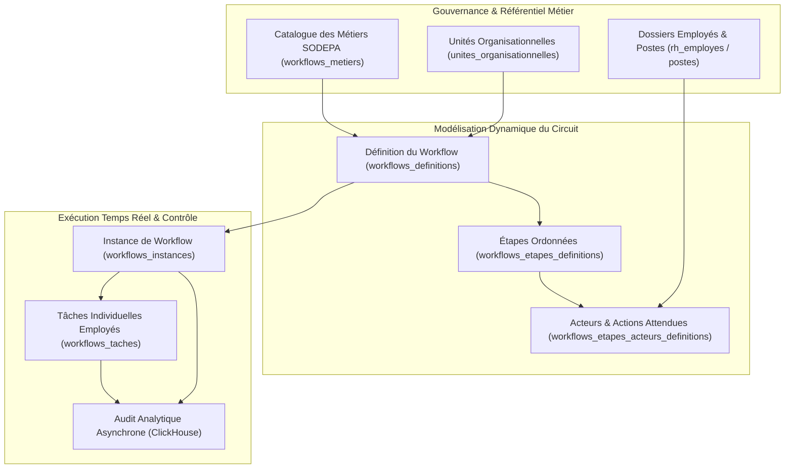
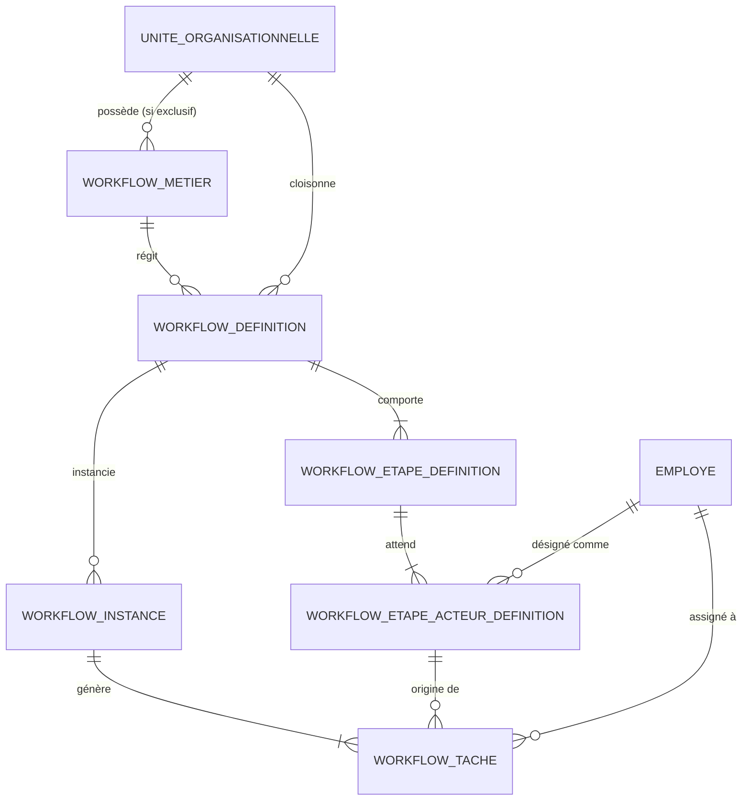
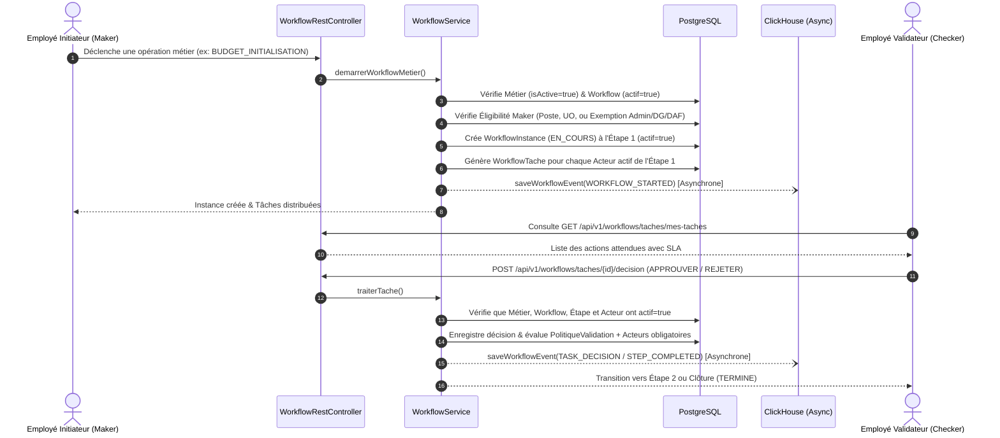

# Vision Architecturale & Résumé d'Implémentation — Moteur de Workflow Universel SODEPA ERP

## 1. Vision Stratégique & Philosophie du Système

L'objectif central de cette architecture est de doter l'**ERP SODEPA** d'un **Moteur de Workflow Transversal, Universel et Piloté par les Données** (*Data-Driven Workflow Engine*), remplaçant l'ancien pattern *Maker-Checker* statique par une gouvernance granulaire adaptée à la réalité organisationnelle de la SODEPA (Direction Générale, DAF, DRH, DPC, Cellule Informatique, Ranchs Pastoraux de Faro/Ndokayo/Dumbo, Abattoirs Industriels de Yaoundé/Douala/Ngaoundéré et Station de Jakiri).

### Les 5 Piliers de la Vision SODEPA

1. **Zéro Code en Dur (*Zero Hardcoding*) via le Registre des Métiers** :
   Chaque fonctionnalité de l'ERP (Recrutement, Crédit/Débit comptable, Virement bancaire, Engagement budgétaire, Mouvement de cheptel, Abattage, Note de service, etc.) est déclarée en base de données comme un **Métier** ([`WorkflowMetierEntity.java`](file:///c:/Users/GLC/Documents/sodepa/erp/src/main/java/com/sodepa/erp/workflow/infrastructure/entities/WorkflowMetierEntity.java)).
2. **Centré sur l'Employé et non le simple Compte Technique** :
   Les responsabilités d'initiation (*Maker*) et de validation (*Checker*) reposent sur l'**Employé** ([`EmployeEntity.java`](file:///c:/Users/GLC/Documents/sodepa/erp/src/main/java/com/sodepa/erp/rh/infrastructure/entities/EmployeEntity.java)), son **Poste** dans l'organigramme et son **Unité Organisationnelle**.
3. **Cloisonnement Hermétique par Unité Organisationnelle (Multi-Cellules)** :
   - *Métiers exclusifs* (`isTransversal = false`) : Seuls les employés de l'unité propriétaire peuvent initier ou consulter les flux (ex. M. Kamga à la Comptabilité gère les écritures comptables ; M. Atangana à la Cellule Informatique ne peut ni les voir ni les modifier).
   - *Métiers transversaux* (`isTransversal = true`) : Chaque cellule (ex. Informatique, Comptabilité, Ranch) peut initier son propre flux (ex. *Rédiger une note de service*) avec ses propres validateurs internes, dans une isolation stricte vis-à-vis des autres cellules.
4. **Exemption de Super-Gouvernance** :
   Les rôles **Administrateur**, **Directeur Général (DG)**, **Directeur Administratif et Financier (DAF)** et **Membres du Conseil d'Administration (CA)** disposent d'une visibilité transversale complète et sont exemptés des verrous d'éligibilité lors de la création de nouveaux processus métiers.
5. **Coupe-Circuit Immédiat (`active = false` Stoppe Tout)** :
   Tout élément positionné à `active = false` (`isActive = false` ou `actif = false`) — qu'il s'agisse d'un métier, d'un workflow, d'une étape, d'un validateur ou d'un utilisateur — interrompt immédiatement l'action en cours.

> [!IMPORTANT]
> **Règle d'Or Coupe-Circuit (`active = false`)** : Si un workflow en cours d'exécution atteint une étape dont `actif = false`, ou si le métier sous-jacent passe à `isActive = false`, le moteur bloque immédiatement la transition et rejette l'opération avec une erreur explicite.

---

## 2. Modèle Conceptuel de Données (MCD Cible)

### Détail des Entités Clés

- **[`WorkflowMetierEntity.java`](file:///c:/Users/GLC/Documents/sodepa/erp/src/main/java/com/sodepa/erp/workflow/infrastructure/entities/WorkflowMetierEntity.java)** (`workflows_metiers`) :
  - `code` (unique), `title`, `description`, `domain` (`WorkflowDomaine`), `isTransversal`, `isActive`, `authorizedUnit` (`UniteOrganisationnelleEntity`).
- **[`WorkflowDefinitionEntity.java`](file:///c:/Users/GLC/Documents/sodepa/erp/src/main/java/com/sodepa/erp/workflow/infrastructure/entities/WorkflowDefinitionEntity.java)** (`workflows_definitions`) :
  - Reliée à un `metier` et optionnellement à une `uniteOrganisationnelle` spécifique, avec contrôle des `rolesInitiateurs` et `postesInitiateurs`.
- **[`WorkflowEtapeDefinitionEntity.java`](file:///c:/Users/GLC/Documents/sodepa/erp/src/main/java/com/sodepa/erp/workflow/infrastructure/entities/WorkflowEtapeDefinitionEntity.java)** (`workflows_etapes_definitions`) :
  - `ordre`, `codeEtape`, `intitule`, `typeEtape`, `politiqueValidation` (`UN_SEUL_SUFFIT`, `TOUS_DOIVENT_VALIDER`, `MAJORITE_SIMPLE`), `delaiSlaHeures`, `actionDepassementSla`, `actif` (`boolean default true`).
- **[`WorkflowEtapeActeurDefinitionEntity.java`](file:///c:/Users/GLC/Documents/sodepa/erp/src/main/java/com/sodepa/erp/workflow/infrastructure/entities/WorkflowEtapeActeurDefinitionEntity.java)** (`workflows_etapes_acteurs_definitions`) :
  - Définit précisément **qui** doit intervenir (`employe`, `utilisateur`, `uniteOrganisationnelle`, `strategieAssignation`, `valeurAssignation`), **quelle action** est attendue (`intituleAction`), si sa validation est **requise ou optionnelle** (`obligatoire`), et son statut (`actif`).
- **[`WorkflowTacheEntity.java`](file:///c:/Users/GLC/Documents/sodepa/erp/src/main/java/com/sodepa/erp/workflow/infrastructure/entities/WorkflowTacheEntity.java)** (`workflows_taches`) :
  - Trace en temps réel l'état de l'action de chaque validateur (`EN_ATTENTE`, `APPROUVEE`, `REJETEE`, `DELEGUEE`, `EXPIREE`) pour déterminer si l'étape A peut passer à l'étape B.

---

## 3. Cycle d'Exécution & Résolution des Acteurs

### Règles de Jointure d'Assignation & Validateur `SYSTEME`

- **Priorité de résolution d'un acteur** :
  1. `employe_id` ou `utilisateur_id` fixe (`UTILISATEUR_FIXE`).
  2. `POSTE_SPECIFIQUE` (`valeurAssignation` = code du poste dans l'organigramme).
  3. `RESPONSABLE_STRUCTURE` / `MANAGER_N1` / `MANAGER_N2` (calculé dynamiquement via le `materialized_path` de l'unité organisationnelle de l'initiateur).
  4. `ROLE_KEYCLOAK` (filtré par l'unité organisationnelle si applicable).
- **Cas où le validateur est `SYSTEME` (`TypeEtapeWorkflow.CONTROLE_AUTOMATIQUE`)** :
  - Aucune tâche humaine bloquante n'est mise en attente. Le moteur exécute immédiatement la vérification système, trace l'audit dans PostgreSQL et ClickHouse, et avance automatiquement à l'étape suivante dans la même transaction.

---

## 4. Catalogue des APIs REST Ajoutées

Toutes les routes sont exposées dans [`WorkflowRestController.java`](file:///c:/Users/GLC/Documents/sodepa/erp/src/main/java/com/sodepa/erp/workflow/api/WorkflowRestController.java) :

| Méthode | Endpoint REST | Rôle Fonctionnel |
| :--- | :--- | :--- |
| `POST` | `/api/v1/workflows/definitions` | Création complète d'un workflow avec étapes et validateurs ([`CreerWorkflowDefinitionRequest.java`](file:///c:/Users/GLC/Documents/sodepa/erp/src/main/java/com/sodepa/erp/workflow/api/dto/CreerWorkflowDefinitionRequest.java)). |
| `PUT` | `/api/v1/workflows/definitions/{id}` | Modification complète d'un workflow existant ([`ModifierWorkflowDefinitionRequest.java`](file:///c:/Users/GLC/Documents/sodepa/erp/src/main/java/com/sodepa/erp/workflow/api/dto/ModifierWorkflowDefinitionRequest.java)). |
| `PATCH` | `/api/v1/workflows/definitions/{defId}/etapes/{etapeId}/statut?actif=true/false` | Activation / Désactivation d'une étape. |
| `PATCH` | `/api/v1/workflows/definitions/{defId}/etapes/{etapeId}/acteurs/{acteurId}/statut?actif=true/false` | Activation / Désactivation d'un validateur sur une étape. |
| `GET` | `/api/v1/workflows/metiers` | Liste complète des processus métiers SODEPA. |
| `POST` | `/api/v1/workflows/metiers` | Création d'un processus métier (soumis au workflow `CREATION_METIER` sauf pour Admin, DG et DAF). |
| `PUT` | `/api/v1/workflows/metiers/{id}` | Modification d'un processus métier. |
| `PATCH` | `/api/v1/workflows/metiers/{id}/statut?isActive=true/false` | Activation / Désactivation d'un processus métier. |
| `GET` | `/api/v1/workflows/taches/mes-taches` | Boîte de réception des actions attendues de l'utilisateur connecté. |
| `POST` | `/api/v1/workflows/taches/{tacheId}/decision` | Prise de décision (`APPROUVER`, `REJETER`, `DEMANDER_REVISION`). |

---

## 5. Remplacement du Maker-Checker & Audit ClickHouse

1. **Migration du Pattern Maker-Checker vers le Moteur de Workflow** :
   - [`MakerCheckerEngineAdapter.java`](file:///c:/Users/GLC/Documents/sodepa/erp/src/main/java/com/sodepa/erp/core/makerchecker/MakerCheckerEngineAdapter.java) délègue désormais toutes les demandes de validation au moteur universel [`WorkflowService.java`](file:///c:/Users/GLC/Documents/sodepa/erp/src/main/java/com/sodepa/erp/workflow/business/WorkflowService.java) tout en maintenant le lien `workflowInstanceId` dans [`MakerCheckerRequestEntity.java`](file:///c:/Users/GLC/Documents/sodepa/erp/src/main/java/com/sodepa/erp/core/makerchecker/MakerCheckerRequestEntity.java).
2. **Audit Analytique Asynchrone dans ClickHouse** :
   - Création de la table `clickhouse_workflow_events` dans [`ClickHouseManager.java`](file:///c:/Users/GLC/Documents/sodepa/erp/src/main/java/com/sodepa/erp/audit/infrastructure/repo/ClickHouseManager.java) et du record [`WorkflowEventMessageInput.java`](file:///c:/Users/GLC/Documents/sodepa/erp/src/main/java/com/sodepa/erp/audit/application/inputs/WorkflowEventMessageInput.java).
   - Chaque action (création, démarrage, décision d'étape, rejet, modification de statut) est persistée de manière **asynchrone** dans ClickHouse.

---

## 6. Harmonisation des 5 Seeders & Initialisation des Données

Les 5 seeders de démarrage ont été alignés selon une séquence déterministe `@Order(1)` à `@Order(5)` :

| Ordre | Seeder | Responsabilités Clés |
| :---: | :--- | :--- |
| `@Order(1)` | [`SodepaScrapedDataSeeder.java`](file:///c:/Users/GLC/Documents/sodepa/erp/src/main/java/com/sodepa/erp/organigramme/infrastructure/adapter/SodepaScrapedDataSeeder.java) | Purge dynamique PL/pgSQL (`pg_tables`), ClickHouse et Keycloak. Crée `admin_maker` & `admin_checker`, les paramètres système, l'organigramme réel SODEPA (11 types de structures, UOs, postes, employés, affectations), **8 Banques** et **16 Tiers**. |
| `@Order(2)` | [`UserSeeder.java`](file:///c:/Users/GLC/Documents/sodepa/erp/src/main/java/com/sodepa/erp/user/infrastructure/adapter/UserSeeder.java) | Garantit que les super-administrateurs `admin_maker` et `admin_checker` sont présents, dotés de toutes les permissions et actifs (`isActif() == true`), avec repli résilient si Keycloak est hors ligne. |
| `@Order(3)` | [`CompteSeeder.java`](file:///c:/Users/GLC/Documents/sodepa/erp/src/main/java/com/sodepa/erp/comptabilite/generale/infrastructure/adapter/CompteSeeder.java) | Initialise le Plan Comptable SYSCOHADA depuis `planComptableOHADA.json`. |
| `@Order(4)` | [`TestDataSeeder.java`](file:///c:/Users/GLC/Documents/sodepa/erp/src/main/java/com/sodepa/erp/configuration/TestDataSeeder.java) | Génère les journaux, immobilisations, axes analytiques, budgets et 10 années d'historique comptable et de trésorerie (2017–2026). |
| `@Order(5)` | [`WorkflowSeeder.java`](file:///c:/Users/GLC/Documents/sodepa/erp/src/main/java/com/sodepa/erp/workflow/infrastructure/seeder/WorkflowSeeder.java) | Initialise **35+ opérations métiers SODEPA** couvrant tous les départements et **70 définitions de workflows** reliées automatiquement à leurs métiers respectifs. |

---

## 7. Interfaces Web (`sodepa-frontend` — Angular 18)

- **[`workflow.model.ts`](file:///c:/Users/GLC/Documents/sodepa/sodepa-frontend/src/app/core/models/workflow.model.ts) & [`workflow.service.ts`](file:///c:/Users/GLC/Documents/sodepa/sodepa-frontend/src/app/core/services/workflow.service.ts)** :
  - Intégration complète des nouveaux endpoints REST (`definitions`, `metiers`, `etapes/{id}/statut`, `acteurs/{id}/statut`, `taches/mes-taches`, `decision`).
- **Constructeur / Éditeur Visuel de Workflow** ([`creer-workflow-dialog.component.ts`](file:///c:/Users/GLC/Documents/sodepa/sodepa-frontend/src/app/features/workflow/components/creer-workflow-dialog/creer-workflow-dialog.component.ts)) :
  - Création et modification complète d'un circuit, liaison au métier SODEPA, ajout/suppression d'étapes, configuration des acteurs et des délais SLA.
- **Panneau de Contrôle d'Étape** ([`panneau-etape.component.ts`](file:///c:/Users/GLC/Documents/sodepa/sodepa-frontend/src/app/features/workflow/components/panneau-etape/panneau-etape.component.ts)) :
  - Interrupteur d'activation/désactivation d'étape et d'acteur en temps réel avec indicateur d'arrêt d'action.
- **Boîte de Réception Utilisateur ("Mes Tâches")** ([`boite-reception.component.ts`](file:///c:/Users/GLC/Documents/sodepa/sodepa-frontend/src/app/features/workflow/boite-reception/boite-reception.component.ts)) :
  - Liste personnalisée de toutes les validations attendues de l'employé connecté, suivi SLA et modale de décision.
- **Registre des Métiers SODEPA** ([`workflow.component.html`](file:///c:/Users/GLC/Documents/sodepa/sodepa-frontend/src/app/features/workflow/workflow.component.html)) :
  - Vue dédiée au pilotage des métiers SODEPA par domaine avec bascule `isActive` en un clic.
