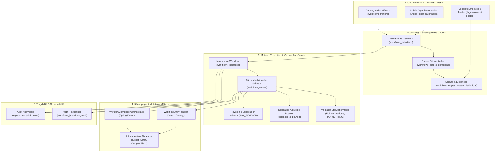
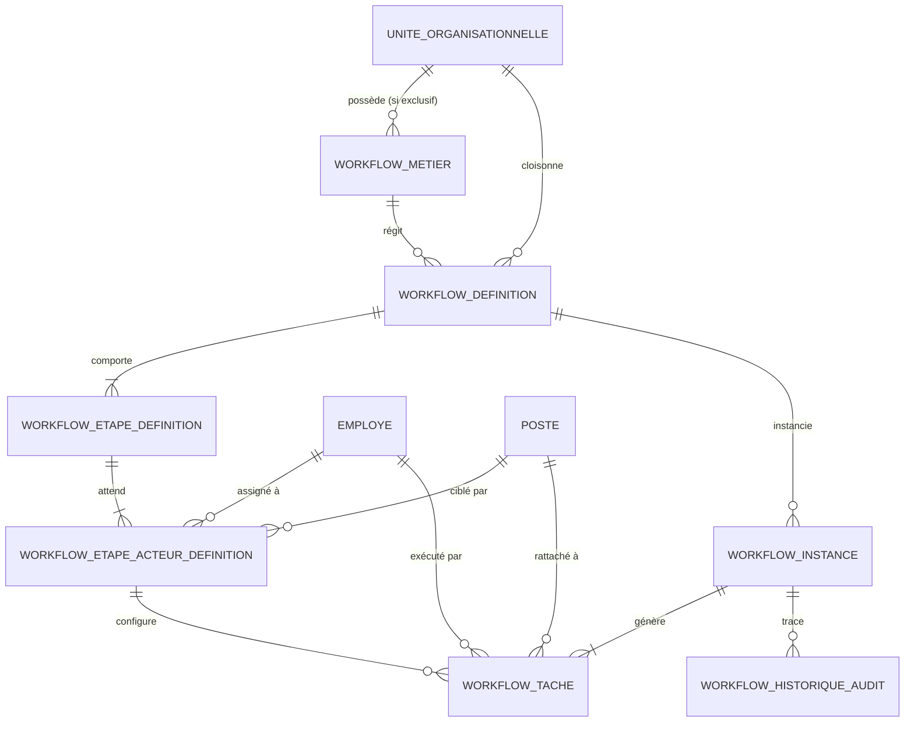
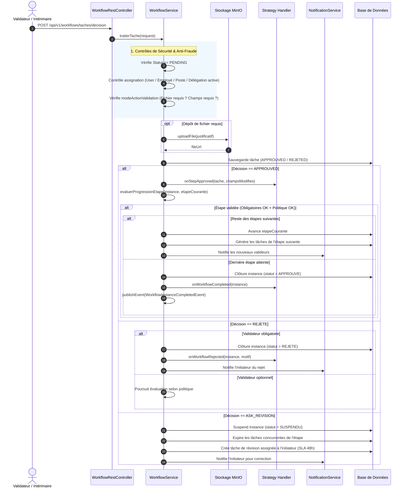
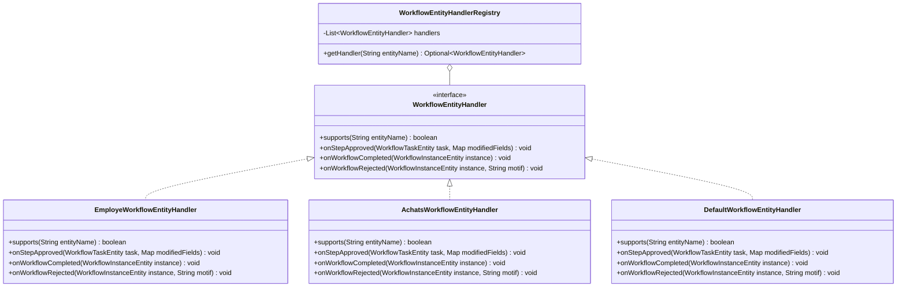
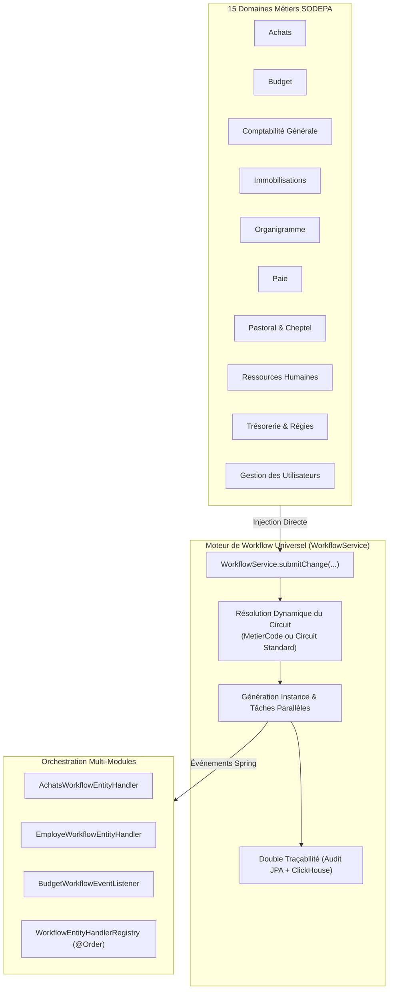

# Vision Architecturale & Spécification d'Implémentation — Moteur de Workflow Universel SODEPA ERP

## 1. Vision Stratégique & Philosophie du Système

L'objectif central de cette architecture est de doter l'**ERP SODEPA** d'un **Moteur de Workflow Transversal, Universel, Piloté par les Données (*Data-Driven Workflow Engine*) et Découplé**, remplaçant l'ancien pattern *Maker-Checker* rigide par une gouvernance granulaire adaptée à la réalité opérationnelle de la SODEPA (Direction Générale, DAF, DRH, DPC, Cellule Informatique, Ranchs Pastoraux de Faro, Ndokayo et Dumbo, Abattoirs Industriels de Yaoundé, Douala et Ngaoundéré, Station de Jakiri).

---

### Les 7 Piliers Fondamentaux de l'Architecture

1. **Zéro Code en Dur (*Zero Hardcoding*) via le Registre des Métiers** :
   Chaque processus métier de l'ERP (Recrutement, Note de service, Virement bancaire, Demande d'achat, Engagement budgétaire, Abattage...) est répertorié dans [`WorkflowMetierEntity.java`](file:///c:/Users/GLC/Documents/sodepa/erp/src/main/java/com/sodepa/erp/workflow/infrastructure/entities/WorkflowMetierEntity.java). La résolution du circuit approprié se fait dynamiquement sans logique figée dans le code.
2. **Identification Centrée sur l'Employé et son Poste** :
   L'ERP SODEPA ancre l'imputabilité sur l'**Employé** ([`EmployeEntity.java`](file:///c:/Users/GLC/Documents/sodepa/erp/src/main/java/com/sodepa/erp/rh/infrastructure/entities/EmployeEntity.java)) et son **Poste** dans l'organigramme hiérarchique, et non sur un simple login technique.
3. **Cloisonnement Hermétique Multi-Cellules & Exclusivité Territoriale** :
   - *Métiers exclusifs* (`isTransversal = false`) : Réservés strictement aux collaborateurs de l'unité propriétaire (ex. Seul le service Comptabilité traite les écritures comptables).
   - *Métiers transversaux* (`isTransversal = true`) : Chaque unité (Informatique, Ranch, Abattoir) peut initier son propre circuit isolé (ex. Note de service, demande de fournitures).
4. **Exemption de Super-Gouvernance** :
   Les profils **Administrateur**, **Directeur Général (DG)** et **Directeur Administratif et Financier (DAF)** possèdent une vision panoramique globale et sont exemptés des restrictions d'initiation et de consultation cellulaire.
5. **Coupe-Circuit Immédiat (`actif = false`)** :
   Tout composant désactivé (`isActive = false` sur un métier, `actif = false` sur un circuit, une étape ou un acteur) bloque instantanément l'exécution du workflow à ce niveau.
6. **Contraintes d'Actions Granulaires (`ValidationStepActionMode`)** :
   Chaque validateur est soumis à une obligation d'action précise pour valider son visa :
   - `DO_NOTHING` : Simple visa d'accord ou d'avis.
   - `ADD_FILE` : Dépôt obligatoire d'une pièce justificative (stockée sur MinIO).
   - `SET_ATTRIBUTE` : Saisie ou modification obligatoire d'attributs de données.
   - `FILE_AND_ATTRIBUTE` : Justificatif ET modification d'attributs obligatoires.
   - `OPTIONAL_FILE_OR_ATTRIBUTE` : Justificatifs ou attributs facultatifs.
7. **Découplage Métier par Strategy Pattern (`WorkflowEntityHandler`)** :
   Le moteur universel de workflow ignore les détails d'implémentation des entités métiers sous-jacentes. Il dialogue à travers l'interface [`WorkflowEntityHandler.java`](file:///c:/Users/GLC/Documents/sodepa/erp/src/main/java/com/sodepa/erp/workflow/application/handler/WorkflowEntityHandler.java) et délègue les mutations d'étapes (`onStepApproved`), la finalisation (`onWorkflowCompleted`) et le rejet (`onWorkflowRejected`).

---

## 2. Modèle Conceptuel de Données (MCD)

### Entités Clés du Domaine Workflow

| Entité JPA | Table BD | Rôle et Responsabilités |
| :--- | :--- | :--- |
| [`WorkflowMetierEntity`](file:///c:/Users/GLC/Documents/sodepa/erp/src/main/java/com/sodepa/erp/workflow/infrastructure/entities/WorkflowMetierEntity.java) | `workflows_metiers` | Registre des actes métiers (`code`, `title`, `domain`, `isTransversal`, `isActive`, `authorizedUnit`). |
| [`WorkflowDefinitionEntity`](file:///c:/Users/GLC/Documents/sodepa/erp/src/main/java/com/sodepa/erp/workflow/infrastructure/entities/WorkflowDefinitionEntity.java) | `workflows_definitions` | Définition d'un circuit (`code` auto-généré `WFD-xxxxxxxx`, `intitule`, `domaine`, `rolesInitiateurs`, `postesInitiateurs`, `version`, `actif`). |
| [`WorkflowEtapeDefinitionEntity`](file:///c:/Users/GLC/Documents/sodepa/erp/src/main/java/com/sodepa/erp/workflow/infrastructure/entities/WorkflowEtapeDefinitionEntity.java) | `workflows_etapes_definitions` | Étape ordonnée du circuit (`ordre`, `codeEtape`, `intitule`, `typeEtape`, `politiqueValidation`, `delaiSlaHeures`, `actionDepassementSla`, `actif`). |
| [`WorkflowEtapeActeurDefinitionEntity`](file:///c:/Users/GLC/Documents/sodepa/erp/src/main/java/com/sodepa/erp/workflow/infrastructure/entities/WorkflowEtapeActeurDefinitionEntity.java) | `workflows_etapes_acteurs_definitions` | Acteur ou collège de validation attendu (`intituleAction`, `employe`, `utilisateur`, `poste`, `strategieAssignation`, `valeurAssignation`, `modeActionValidation`, `obligatoire`, `canBeDelegate`, `donnees_json`, `delaiSlaHeures`). |
| [`WorkflowInstanceEntity`](file:///c:/Users/GLC/Documents/sodepa/erp/src/main/java/com/sodepa/erp/workflow/infrastructure/entities/WorkflowInstanceEntity.java) | `workflows_instances` | Instance en cours d'exécution (`entityName`, `entityId`, `initiateur`, `initiateurEmploye`, `uniteOrganisationnelle`, `statut`, `etapeCourante`, `donneesContexte`, dates). |
| [`WorkflowTaskEntity`](file:///c:/Users/GLC/Documents/sodepa/erp/src/main/java/com/sodepa/erp/workflow/infrastructure/entities/WorkflowTaskEntity.java) | `workflows_taches` | Tâche individuelle distribuée à un validateur (`statut`, `decision`, `assigneEmploye`, `assigneUser`, `assignePoste`, `modeActionValidation`, `currentData`, `dateEcheance`, `obligatoire`, `isDelegated`). |
| [`WorkflowHistoriqueAuditEntity`](file:///c:/Users/GLC/Documents/sodepa/erp/src/main/java/com/sodepa/erp/workflow/infrastructure/entities/WorkflowHistoriqueAuditEntity.java) | `workflows_historique_audit` | Journalisation immuable de chaque événement d'approbation, rejet, révision ou clôture. |

---

## 3. Mécanique d'Exécution & Cycle de Vie

### A. Démarrage d'un Circuit (`demarrerWorkflowMetier`)
1. **Résolution du Métier et du Circuit** : Recherche du métier via son code (ex: `RECRUITMENT`, `ACHAT_MATERIEL`) puis résolution de la définition active rattachée à l'unité de l'agent.
2. **Contrôle d'Éligibilité Maker** :
   - Vérifie si l'initiateur est actif et possède les habilitations requises (`postesInitiateurs`, `rolesInitiateurs`).
   - Les profils `ADMIN`, `DG` et `DAF` sont exemptés d'office.
3. **Création de l'Instance** :
   - Statut positionné à `EN_COURS`.
   - Contexte sérialisé en JSON (`donneesContexte`).
4. **Distribution Initiale des Tâches (`createNextStepTask`)** :
   - Pour chaque acteur actif configuré sur l'étape 1, une `WorkflowTaskEntity` est créée au statut `PENDING`.
   - Résolution dynamique du validateur : employé direct, utilisateur, poste de l'organigramme, ou stratégie (`MANAGER_N1`, `ROLE_KEYCLOAK`, etc.).
   - Calcul de la date d'échéance selon le SLA configuré (`dateCreation + delaiSlaHeures`).
5. **Notification & Audit** :
   - Envoi de notifications multi-canaux (SMS et Email) via [`NotificationService`](file:///c:/Users/GLC/Documents/sodepa/erp/src/main/java/com/sodepa/erp/notification/application/NotificationService.java).
   - Enregistrement dans PostgreSQL et publication asynchrone vers ClickHouse.

---

### B. Traitement d'une Tâche (`traiterTache`)

---

### C. Règles de Progression d'Étape (`evaluerProgressionEtape`)

Une étape est considérée comme validée si et seulement si :
1. **Acteurs Obligatoires (`obligatoire = true`)** :
   - **100% des acteurs obligatoires** doivent avoir approuvé (`StatutWorkflowTache.APPROUVED`).
   - Tout rejet d'un acteur obligatoire entraîne l'annulation définitive du dossier.
2. **Acteurs Optionnels / Collèges (`obligatoire = false`)** :
   - Évalués selon la [`PolitiqueValidation`](file:///c:/Users/GLC/Documents/sodepa/erp/src/main/java/com/sodepa/erp/workflow/infrastructure/entities/PolitiqueValidation.java) configurée sur l'étape :
     - `ONLY_ONE_CAN_VALIDATE` : Un seul accord parmi les membres optionnels suffit.
     - `EVERY_BODY_CAN_VALIDATE` : Tous les membres doivent avoir approuvé.
     - `MUST_HAVE_MAJORITY` : La stricte majorité absolue des membres (> 50%) doit avoir approuvé.

---

### D. Renvoi pour Révision & Suspension Initiateur (`ASK_REVISION`)

Lorsqu'un validateur émet des réserves ou sollicite des compléments :
1. L'instance bascule à l'état `SUSPENDU`.
2. **Coupe-circuit concurrentiel** : Toutes les autres tâches en cours de cette même étape sont immédiatement expirées (`StatutWorkflowTache.EXPIRED`) avec le commentaire `"Tâche suspendue : dossier renvoyé pour révision à l'initiateur."`.
3. Une nouvelle tâche de révision est créée pour l'initiateur :
   - Intitulé : `"Révision / Correction suite aux réserves sur {codeEtape}"`.
   - Échéance SLA : paramétrée sur le délai de l'étape ou 48 heures par défaut.
   - Mode d'action : `OPTIONAL_FILE_OR_ATTRIBUTE`.
4. L'initiateur reçoit une notification immédiate (SMS + Email) pour corriger son dossier et le re-soumettre.

---

## 4. Découplage Métier par Strategy Pattern

Pour éviter d'encombrer le moteur de workflow avec des logiques métiers spécifiques à chaque département (RH, Finances, Ranchs, Achats), le pattern **Strategy** a été introduit :

### Support Multi-Modules & Collaboration Transverse
Un même circuit de validation peut faire intervenir plusieurs modules métiers simultanément ou séquentiellement :
1. **Registre Ordonné Multi-Handlers (`WorkflowEntityHandlerRegistry.getHandlers`)** :
   - Lorsqu'une étape ou une instance est validée, le registre n'exécute pas un seul handler mais **l'ensemble des handlers spécialisés** prenant en charge l'entité, selon leur priorité `@Order`.
   - *Exemple* : Sur un circuit d'Expression de Besoin, le handler **Achats** met à jour le statut (`VISEE_BUDGET`, `APPROUVEE_DG`), tandis qu'un handler ou listener **Budget** assure le pré-engagement et la réservation des crédits.
2. **Architecture Événementielle Découplée (Event-Driven Architecture)** :
   Le moteur émet des événements Spring typés consommables par n'importe quel module sans couplage direct :
   - `WorkflowStepApprovedEvent` : Émis à chaque validation d'étape avec les champs enrichis.
   - `WorkflowInstanceCompletedEvent` : Émis à l'approbation définitive pour clôture.
   - `WorkflowInstanceRejectedEvent` : Émis en cas de rejet pour libérer les ressources réservées.
   - `WorkflowRevisionRequestedEvent` : Émis lors d'un renvoi pour correction (`ASK_REVISION`).

### Rôle des Méthodes Strategy :
- `supports(String entityName)` : Détermine si le handler gère l'entité (ex: `"EMPLOYE"`, `"RH_EMPLOYE"`).
- `onStepApproved(task, modifiedFields)` : Applique les modifications partielles saisies par un validateur (ex. validation médicale, ajustement d'échelon indiciaire).
- `onWorkflowCompleted(instance)` : Déclenche l'activation finale de l'entité (ex. passage de l'employé au statut `ACTIF`, affectation du matricule, création automatique du compte utilisateur et rattachement au poste).
- `onWorkflowRejected(instance, motif)` : Archive ou annule l'entité métier avec consignation du motif de rejet.

---

## 5. Catalogue des APIs REST

Exposées sur le contrôleur [`WorkflowRestController.java`](file:///c:/Users/GLC/Documents/sodepa/erp/src/main/java/com/sodepa/erp/workflow/presentation/rest/WorkflowRestController.java) :

| Méthode | Endpoint REST | Description & Sécurité |
| :--- | :--- | :--- |
| `POST` | `/api/v1/workflows/definitions` | Création d'un circuit avec génération automatique du code (`WFD-xxxxxxxx`). |
| `PUT` | `/api/v1/workflows/definitions/{id}` | Modification d'un circuit existant avec incrémentation de version. |
| `GET` | `/api/v1/workflows/definitions` | Pagination des circuits selon les habilitations et postes de l'utilisateur. |
| `PATCH` | `/api/v1/workflows/definitions/{defId}/etapes/{etapeId}/statut` | Activation/Désactivation d'une étape (`actif=true/false`). |
| `PATCH` | `/api/v1/workflows/definitions/{defId}/etapes/{etapeId}/acteurs/{actId}/statut` | Activation/Désactivation d'un validateur. |
| `GET` | `/api/v1/workflows/metiers` | Consultation du registre des processus métiers SODEPA. |
| `POST` | `/api/v1/workflows/metiers` | Création d'un métier (contrôlé par workflow de gouvernance sauf Admin/DG/DAF). |
| `POST` | `/api/v1/workflows/instances/demarrer-metier` | Démarrage d'un workflow par code métier (recommandé). |
| `GET` | `/api/v1/workflows/taches/mes-taches` | Boîte de réception personnalisée des tâches de l'agent connecté avec SLA. |
| `POST` | `/api/v1/workflows/taches/decision` | Prise de décision sur une tâche (`APPROUVED`, `REJETE`, `ASK_REVISION`) avec upload optionnel/obligatoire et champs modifiés. |
| `GET` | `/api/v1/workflows/instances/{id}` | Suivi en temps réel de l'avancement et de l'historique complet d'un dossier. |

---

## 6. Observabilité & Piste d'Audit Infalsifiable

1. **Audit Relationnel Transactionnel (`workflows_historique_audit`)** :
   - Chaque action (`INITIATION`, `APPROBATION`, `REJET`, `DEMANDE_REVISION`, `CLOTURE`) est consignée dans la même transaction SQL que la décision, avec l'identifiant de l'agent, le timestamp et les commentaires.
2. **Audit Analytique Asynchrone (ClickHouse)** :
   - Ingestion dans `clickhouse_workflow_events` via [`ClickHouseManager`](file:///c:/Users/GLC/Documents/sodepa/erp/src/main/java/com/sodepa/erp/audit/infrastructure/repo/ClickHouseManager.java).
   - Permet d'alimenter les tableaux de bord décisionnels de la Direction Générale : temps moyen de traitement par étape, goulots d'étranglement par unité organisationnelle, respect des SLA, et volumétrie des flux.

---

## 7. Convergence Universelle & Remplacement Direct de `MakerCheckerEnginePort`

### A. Contexte et Décision d'Architecture
Historiquement, l'ERP SODEPA disposait d'un pattern double :
1. Une interface rigide et binaire `MakerCheckerEnginePort` / `MakerCheckerEngineAdapter` (soumission, acceptation/rejet sans notion d'étapes multiples ni d'acteurs hiérarchiques).
2. Le **Moteur de Workflow Universel** (`WorkflowService`), capable de gérer des graphes de validation complexes, des SLA, des politiques d'approbation et des verrous anti-fraude.

Afin de simplifier la maintenance, d'éviter la duplication de logique et d'offrir la puissance du moteur de workflow à l'ensemble de l'ERP, **`MakerCheckerEnginePort` et `MakerCheckerEngineAdapter` ont été définitivement supprimés**.

### B. Modules Migrés en Injection Directe vers `WorkflowService`
Les 15 classes appelantes injectent désormais directement `WorkflowService` :
1. `AchatsSecurityService.java` (`com.sodepa.erp.achats.application`)
2. `AchatsService.java` (`com.sodepa.erp.achats.application`)
3. `BudgetPlanAdapter.java` (`com.sodepa.erp.budget.infrastructure.adapter`)
4. `BankAdapter.java` (`com.sodepa.erp.comptabilite.generale.infrastructure.adapter`)
5. `CompteAdapter.java` (`com.sodepa.erp.comptabilite.generale.infrastructure.adapter`)
6. `FiscalYearClosingAdapter.java` (`com.sodepa.erp.comptabilite.generale.infrastructure.adapter`)
7. `ImmobilisationAdapter.java` (`com.sodepa.erp.comptabilite.generale.infrastructure.adapter`)
8. `JournalAdapter.java` (`com.sodepa.erp.comptabilite.generale.infrastructure.adapter`)
9. `TiersAdapter.java` (`com.sodepa.erp.comptabilite.generale.infrastructure.adapter`)
10. `OrganigrammeAdapter.java` (`com.sodepa.erp.organigramme.infrastructure.adapter`)
11. `PaieService.java` (`com.sodepa.erp.paie.application`)
12. `CheptelService.java` (`com.sodepa.erp.pastoral.application`)
13. `RhService.java` (`com.sodepa.erp.rh.application`)
14. `RegiesTresorerieService.java` (`com.sodepa.erp.tresorerie.regies.application`)
15. `UserAdapter.java` (`com.sodepa.erp.user.infrastructure.adapter`)

### C. Maintien de l'API de Soumission et Orchestration Automatique
Les méthodes de soumission (`submitChange`, `directSubmitChange`, `findById`, `update`, `validate`, `findAllToValideByOther`) sont intégrées dans `WorkflowService` :
- Lors de l'appel à `submitChange(entityName, entityPk, payload, opType)`, une entrée de suivi `MakerCheckerRequestEntity` est persistée, et une instance réelle de workflow `WorkflowInstanceEntity` est déclenchée immédiatement via `demarrerWorkflowPourEntite`.
- L'audit analytique ClickHouse est émis de manière asynchrone non-bloquante via RabbitMQ (`AuditEventPublisher`).

---

## 8. Matrice de Résolution des 12 Défaillances (D1 à D12)

Le tableau ci-dessous synthétise la résolution formelle des 12 écarts relevés dans le rapport d'audit et de revue du moteur de workflow :

| Réf | Défaillance Identifiée | Risque Initial | Solution Implémentée | Statut |
| :--- | :--- | :--- | :--- | :---: |
| **D1** | Identité de l'appelant non garantie | Usurpation d'identité en passant un `userId` arbitraire | Extraction stricte de l'utilisateur connecté via le token JWT Bearer (`utilsService.getCurrentUser()`) | **RÉSOLU** |
| **D2** | Absence de permissions RBAC dédiées | N'importe quel utilisateur connecté pouvait modifier des circuits | Création et contrôle strict des permissions `WORKFLOW_READ`, `WORKFLOW_CONFIG`, `WORKFLOW_SUPERVISION`, `WORKFLOW_DECISION` | **RÉSOLU** |
| **D3** | Contrôle superviseur par comparaison de chaîne (`contains("DG")`) | Faux positifs et élévation de privilèges | Remplacement par un contrôle exact sur les rôles et permissions officielles de gouvernance | **RÉSOLU** |
| **D4** | Risque d'auto-approbation (Violation 4-Eyes) | Un initiateur pouvait valider son propre dossier | Blocage systématique : exception `AccesRefuseException` levée si `initiateurId.equals(valideurId)` | **RÉSOLU** |
| **D5** | Blocage du cycle lors de la révision (`ASK_REVISION`) | Dossiers suspendus indéfiniment après demande de correction | Remise en statut `EN_ATTENTE_REVISION`, notification initiateur, et réévaluation cyclique dès resoumission | **RÉSOLU** |
| **D6** | Blocage par les tâches expirées | Circuits arrêtés à 100% car les tâches `EXPIRED` n'étaient pas filtrées | Évaluation dynamique de progression ignorant les tâches de statut `EXPIRED` | **RÉSOLU** |
| **D7** | Absence de verrouillage optimiste | Race conditions en cas de validation simultanée par 2 acteurs | Ajout du champ `@Version private Long version;` sur `WorkflowInstanceEntity` et `WorkflowTaskEntity` | **RÉSOLU** |
| **D8** | Traçabilité insuffisante et perte d'historique | Non-conformité aux exigences d'audit réglementaire | Double piste d'audit : `WorkflowHistoriqueAuditEntity` (relationnel SQL) + ClickHouse asynchrone | **RÉSOLU** |
| **D9** | Rôles et affectations en dur dans le code | Rigidité interdisant l'évolution de l'organigramme | Stratégies dynamiques `POSTE_SPECIFIQUE`, `RESPONSABLE_HIERARCHIQUE`, `ROLE`, et prise en compte des délégations actives | **RÉSOLU** |
| **D10** | Absence d'exigence sur les pièces jointes | Validation sans justificatifs obligatoires | Implémentation du mode `ValidationStepActionMode` avec validation MinIO et attributs requis | **RÉSOLU** |
| **D11** | Pollution *rollback-only* lors de soumissions Maker-Checker | Transaction globale avortée par une sous-opération | Utilisation de `saveAndFlush()` et isolation stricte des contextes transactionnels | **RÉSOLU** |
| **D12** | Conflit *rollback-only* dans le module Achats | Blocage de l'auto-validation sur expressions de besoin | Alignement transactionnel et découplage par événements de domaine | **RÉSOLU** |
