# Portail Documentaire — ERP SODEPA

Bienvenue dans le référentiel documentaire officiel du Système d'Information Intégré (ERP) de la **SODEPA** (*Société de Développement et d'Exploitation des Productions Animales*).

---

## 1. Vue d'Ensemble du Système

L'ERP SODEPA est un système modulaire d'entreprise conçu pour interconnecter en temps réel les **Services Centraux de Yaoundé** (Direction Générale, DAF, SDRH, DPC, Cellule Informatique, Audit) et l'ensemble des **Unités Opérationnelles Décentralisées** (Ranches pastoraux de Dumbo, Jakiri, Faro ; Abattoirs industriels et entrepôts frigorifiques de Yaoundé, Douala, Ngaoundéré).

```mermaid
flowchart TD
    subgraph UI["Front-End Web (Angular 21 / Tailwind CSS 4)"]
        DASH["Tableaux de Bord & Pilotage"]
        REF_UI["Module Référentiels (REF-01 à REF-07)"]
        WF_UI["Boîte de Réception & Workflow Stepper"]
        NOTIF_UI["Cloche Notifications Multicanal"]
    end

    subgraph API["Passerelle & Sécurité (OAuth2 / OIDC)"]
        KC["Keycloak 26 (Realm sodepa)"]
        JWT["Validation JWT / Spring Security 6"]
    end

    subgraph Core["Back-End Spring Boot 4.1 (Clean Architecture)"]
        MDM["Gouvernance MDM & Fiches (REF-01)"]
        ORG["Organigramme & Évolutions CA 2018 (REF-02)"]
        TECH["Référentiel Métiers & Sites (REF-03)"]
        BUD_FISC["Fiscalité, Budget & Exercices (REF-04)"]
        TIERS["Tiers & Partenaires Unifiés (REF-05)"]
        IAM_SOD["IAM Profils & Matrice SoD (REF-06)"]
        GED_MOD["Coffre-fort Numérique GED (REF-07)"]
        NOTIF["Notifications Multicanal (SMS & E-mail)"]
        WF_ENGINE["Moteur Universel de Workflows"]
    end

    subgraph Data["Infrastructure de Persistance & Échanges"]
        PG[(PostgreSQL 15 - Données Transactionnelles)]
        CH[(ClickHouse - Entrepôt Analytique)]
        S3[(MinIO - Documents GED S3)]
        MQ[(RabbitMQ - Bus d'Événements)]
        RD[(Redis - Cache Distribué)]
    end

    UI --> API
    API --> Core
    Core --> Data
```



---

## 2. Sommaire des Guides et Documents d'Architecture

| Document | Emplacement | Description |
|---|---|---|
| **Document de Conception Détaillé (DCD)** | [`docs/architecture/DOCUMENT_CONCEPTION_DETAILLE_ERP_SODEPA.md`](file:///c:/Users/GLC/Documents/sodepa/erp/docs/architecture/DOCUMENT_CONCEPTION_DETAILLE_ERP_SODEPA.md) | Spécification technique approfondie, Clean Architecture, cartographie des 24 changelogs Liquibase et des 8 seeders déterministes. |
| **Matrice de Conformité aux Critères d'Acceptation** | [`docs/architecture/MATRICE_CONFORMITE_CRITERES_ACCEPTATION_REF.md`](file:///c:/Users/GLC/Documents/sodepa/erp/docs/architecture/MATRICE_CONFORMITE_CRITERES_ACCEPTATION_REF.md) | Suivi de recette de l'intégralité des 101 critères d'acceptation (CA) et 28 règles de gestion (RG) du Module 01 (100% Conforme). |
| **Analyse des Écarts & Historique de Cadrage** | [`docs/architecture/ANALYSE_ECARTS_REFERENTIEL_ERP.md`](file:///c:/Users/GLC/Documents/sodepa/erp/docs/architecture/ANALYSE_ECARTS_REFERENTIEL_ERP.md) | Confrontation détaillée entre le Cahier des Charges v1.0 et les briques logicielles délivrées. |
| **Guide d'Exécution des Tests & Allure** | [`docs/TESTING.md`](file:///c:/Users/GLC/Documents/sodepa/erp/docs/TESTING.md) | Procédures de test unitaire, d'intégration, génération des rapports Allure et exécution CI/CD. |

---

## 3. Cartographie Fonctionnelle du Socle Transversal (Module 01)

### REF-01 : Socle MDM & Fiches de Référence
- **Catalogue de familles de référentiels** (`FamilleReferentielEntity`) avec masques de codification dynamiques et gestionnaire technique/métier.
- **Versioning automatique des fiches** (`FicheReferentielVersionEntity`) avec cycle de vie (`BROUILLON`, `SOUMIS`, `VALIDE`, `SUSPENDU`, `ARCHIVE`), date d'effet et audit avant/après JSON.
- **Détection proactive et fusion de doublons** avec conservation de la traçabilité.
- **Import/Export massif CSV** avec contrôle de cohérence.

### REF-02 : Organigramme & Évolutions de Structures
- **Conformité stricte à la Résolution 11/CA/SODEPA/2018** (11 types de structures hiérarchiques).
- **Historique des réorganisations** (`EvolutionStructureOrganigrammeEntity`) avec date de décision, motif et analyse d'impact.
- **Rattachement multidimensionnel** des collaborateurs, postes budgétés et unités.

### REF-03 : Référentiels Métiers & Géographiques
- **Espèces & Races pastorales** camerounaises (Goudali, Red Bororo, etc.).
- **Catalogue des produits et sous-produits animaux** avec valorisation du 5ème quartier.
- **Référentiel sanitaire & vétérinaire** avec gestion obligatoire des délais d'attente (viande et lait).
- **Barèmes d'abattage et de découpe** avec rendements carcasses et saisies vétérinaires.
- **Unités de mesure & matrices de conversion** (ex: Poids vif -> Poids carcasse).
- **Sites d'exploitation & Localités** géographiques rattachés aux zones agro-écologiques.

### REF-04 : Nomenclature Budgétaire & Fiscale
- **Table des taxes camerounaises** : TVA (19.25%), Acomptes d'Impôt sur le Revenu (AIR 2.2%, 5.5%, 15%), exonérations exports.
- **Régimes fiscaux** : Réel, Simplifié, Synthétique.
- **Table des seuils de passation de marchés** (proformas obligatoires, commission des marchés).
- **Nomenclature budgétaire à 4 niveaux** : Programmes, Activités, Sources de financement (BIP, fonds propres, bailleurs), Natures de dépenses.
- **Exercices et périodes mensuelles SYSCOHADA** avec clôture/réouverture sécurisée.
- **Moyens de paiement** (Virement, Chèque, Espèces, Mobile Money) avec plafonds et comptes de caisse/banque.

### REF-05 : Tiers & Partenaires Unifiés
- **Fiche Tiers 360°** unifiée (Clients, Fournisseurs, Éleveurs partenaires, Bailleurs de fonds, Grossistes).
- **Contrôles fiscaux et bancaires** : validation du NIU (14 caractères DGI), RCCM et RIB CEMAC normalisé (23 caractères).
- **Gestion des pièces de conformité** (`PieceConformiteTiersEntity`) avec alerte automatique à J-15 avant expiration et suspension en cas de défaillance.

### REF-06 : IAM, Profils Fonctionnels & Séparation des Tâches (SoD)
- **Profils fonctionnels** (`ProfilFonctionnelEntity`) associant des ensembles de permissions, un plafond de délégation d'engagement en FCFA et l'exigence MFA.
- **Matrice de séparation des tâches SoD** (`RegleSodEntity`) avec blocage systématique en amont des conflits d'intérêts (ex: Initiateur vs Validateur financier).
- **Affectations temporaires et périmètres** géographiques/budgétaires.
- **Revue automatique semestrielle des accès** et révocation immédiate sur événement RH de sortie.

### REF-07 : Coffre-Fort Numérique GED & Workflows
- **Archivage documentaire qualifié** avec scellement par empreinte cryptographique SHA-256.
- **Versioning automatique** (v1, v2) et signature électronique intégrée.
- **Respect de la durée légale de conservation** (10 ans pour les pièces comptables OHADA).
- **Modes d'action de validation par étape** (`ModeActionValidationEtape`) : validation simple, fichier obligatoire, modification de champs imposée ou optionnelle.
- **Système de notifications multicanal** (SMS et E-mail) avec traçabilité et acquittement.

---

## 4. Guide de Démarrage Rapide

### 4.1 Prérequis Système
- **Java** : OpenJDK 21 LTS
- **Node.js** : v20.19+ ou v22+ avec npm 10+
- **Docker & Docker Compose** (pour l'infrastructure sous-jacente)

### 4.2 Lancement de l'Infrastructure Développeur
À la racine du projet backend :
```bash
docker compose up -d postgres keycloak minio rabbitmq redis clickhouse
```

### 4.3 Démarrage du Backend (Spring Boot 4.1)
Exécuter le script PowerShell préparé ou la commande Maven avec le profil `test` :
```powershell
powershell -ExecutionPolicy Bypass -File .\run-backend.ps1
```
*Le serveur démarre sur le port `8087`. Le seeder déterministe initialise les comptes bootstrap, Keycloak, les grilles salariales et les référentiels métiers.*

Vérification de l'état :
- **Santé de l'application** : [http://localhost:8087/actuator/health](http://localhost:8087/actuator/health)
- **Swagger UI** : [http://localhost:8087/swagger-ui.html](http://localhost:8087/swagger-ui.html)
- **Documentation OpenAPI** : [http://localhost:8087/v3/api-docs](http://localhost:8087/v3/api-docs)

### 4.4 Démarrage du Frontend (Angular 21)
Dans le répertoire `../sodepa-frontend` :
```bash
npm install
npm start
```
*L'application est accessible à l'adresse [http://localhost:4200](http://localhost:4200).*

---

## 5. Endpoints REST Majeurs

| Domaine | Méthode & URI | Description |
|---|---|---|
| **MDM** | `GET /api/mdm/familles` | Liste des familles de données de référence |
| **MDM** | `POST /api/mdm/fiches` | Création / soumission d'une nouvelle fiche versionnée |
| **MDM** | `GET /api/mdm/dashboard` | Tableau de bord de gouvernance (complétude, doublons, SLA) |
| **Tiers** | `GET /api/tiers-unifies` | Consultation et recherche 360° des tiers partenaires |
| **Tiers** | `POST /api/tiers-unifies` | Création de tiers avec contrôle NIU et RIB CEMAC |
| **Technique** | `GET /api/referentiel-technique/especes` | Référentiel des espèces et races pastorales |
| **Technique** | `GET /api/referentiel-technique/catalogue-produits` | Catalogue des produits et 5ème quartier |
| **Technique** | `GET /api/referentiel-technique/sanitaire-veterinaire` | Protocoles sanitaires et délais d'attente lait/viande |
| **Fiscalité** | `GET /api/fiscalite/taxes` | Barèmes des taxes officielles et retenues à la source |
| **Budget** | `GET /api/budget/referentiels/programmes` | Nomenclature des programmes et actions |
| **Comptabilité** | `GET /api/comptabilite/exercices` | Exercices et périodes mensuelles SYSCOHADA |
| **IAM** | `GET /api/iam/profils` | Profils fonctionnels, plafonds d'engagement et MFA |
| **IAM** | `GET /api/iam/sod/matrice` | Matrice de séparation des tâches et règles bloquantes |
| **GED** | `POST /api/ged/televerser` | Dépôt de pièce avec scellement SHA-256 et versioning |
| **Notifications** | `GET /api/notifications/actives` | Notifications en attente (SMS / E-mail) de l'utilisateur |

---

## 6. Normes de Développement & Qualité

- **Documentation Java** : 100% des classes, méthodes, entités, DTOs de requête (`Request`) et entrées de services (`Input`) sont documentées au standard Javadoc professionnel avec l'utilité explicite de chaque champ.
- **Architecture Logicielle** : Clean Architecture stricte isolant la couche domaine des frameworks d'infrastructure.
- **Sécurité** : Validation systématique des habilitations via `UtilsService.hasPermission()` et vérification des incompatibilités SoD en amont de toute affectation.
