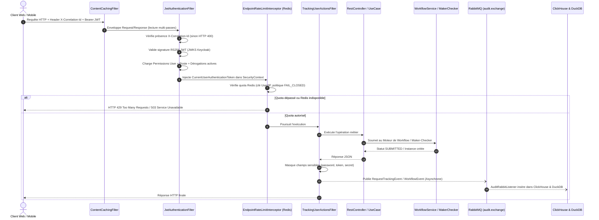
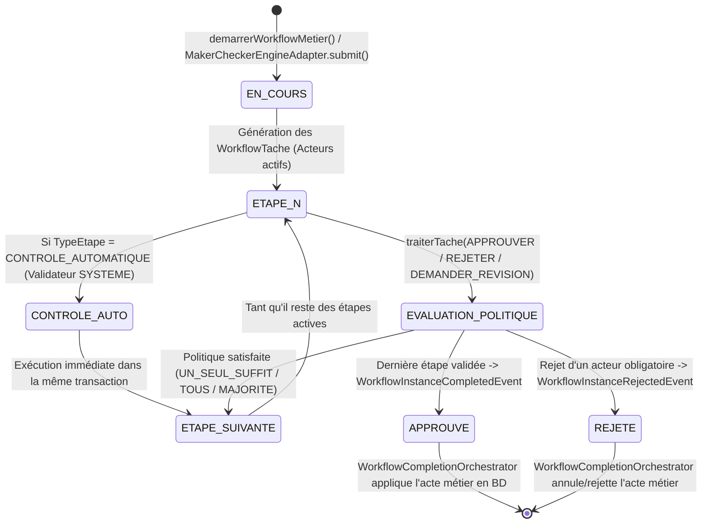
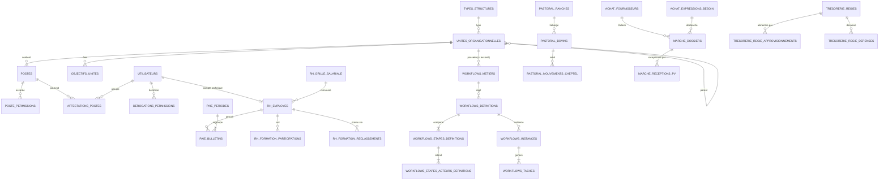

# Document de Conception Détaillé (DCD) — ERP SODEPA

> [!NOTE]
> **Référentiel Technique Issu du Scan Complet du Code Source**
> - **Projet** : Système d'Information Intégré (ERP) de la **SODEPA** (*Société de Développement et d'Exploitation des Productions Animales*)
> - **Artefact Maven** : `com.sodepa:erp:0.0.1-SNAPSHOT` ([`pom.xml`](file:///c:/Users/GLC/Documents/sodepa/erp/pom.xml))
> - **Runtime & Socle** : Java 21 LTS · Spring Boot 4.1.0 · PostgreSQL 15/16 · ClickHouse 26.7 · DuckDB 1.0 · RabbitMQ 3.13 · Redis 7 · Keycloak 26.0 · HashiCorp Vault 1.15 · MinIO S3
> - **Date du scan** : 8 novembre 2026

---

## 1. Vision Architecturale & Principes Directeurs

### 1.1 Contexte Métier SODEPA
L'ERP SODEPA unifie la gestion administrative, financière, comptable (SYSCOHADA révisé), budgétaire, pastorale (suivi zootechnique des bovins), d'achats publics (CIPM) et de capital humain entre :
- **Les Services Centraux (Yaoundé)** : Direction Générale (DG), Direction Administrative et Financière (DAF), Sous-Direction des Ressources Humaines (SDRH), Direction de la Production et de la Commercialisation (DPC), Cellule Informatique, Contrôle de Gestion et Audit Interne.
- **Les Unités Opérationnelles Décentralisées** :
  - **Ranches Pastoraux** : Dumbo (Nord-Ouest, 25 000 ha), Jakiri (Nord-Ouest, 8 000 ha), Faro (Nord, 40 000 ha), Ndokayo (Est).
  - **Abattoirs Industriels & Entrepôts Frigorifiques** : Yaoundé (Etoudi), Douala (Bassa), Ngaoundéré.

### 1.2 Style Architectural : Monolithe Modulaire en Clean Architecture (Hexagonale)
Le code source ([`src/main/java/com/sodepa/erp`](file:///c:/Users/GLC/Documents/sodepa/erp/src/main/java/com/sodepa/erp)) applique une séparation stricte **Ports & Adaptateurs** au sein de chaque domaine métier :

```mermaid
flowchart LR
    subgraph Presentation["1. Couche Présentation (REST)"]
        CTRL["*RestController\n(Validation Jakarta, OpenAPI)"]
        REQ["Requests / Responses\n(DTOs immuables)"]
    end

    subgraph Application["2. Couche Application (Domaine & Use Cases)"]
        UC["@UseCase / *Service\n(Logique métier pure & @Transactional)"]
        PORT["Ports (Interfaces)\nOrganigrammePort, MakerCheckerEnginePort..."]
        ORCH["WorkflowCompletionOrchestrator\n(Écouteur d'événements Spring)"]
    end

    subgraph Infrastructure["3. Couche Infrastructure (Adaptateurs & Persistance)"]
        ADAPT["*Adapter\n(Implémentation des Ports)"]
        REPO["*Repository\n(Spring Data JPA / JDBC)"]
        ENT["*Entity\n(Modèle relationnel JPA/Hibernate)"]
        EXT["Intégrations : Keycloak, MinIO,\nRabbitMQ, ClickHouse, DuckDB, Redis"]
    end

    CTRL --> REQ
    CTRL --> UC
    UC --> PORT
    PORT <|.. ADAPT
    UC --> ORCH
    ADAPT --> REPO
    REPO --> ENT
    ADAPT --> EXT
```

### 1.3 Pile Technologique Confirmée

| Couche | Technologie | Version | Composants Clés dans le Projet |
| :--- | :--- | :--- | :--- |
| **Langage & Framework** | Java LTS / Spring Boot | `21` / `4.1.0` | [`ErpApplication.java`](file:///c:/Users/GLC/Documents/sodepa/erp/src/main/java/com/sodepa/erp/ErpApplication.java), Spring WebMVC, Spring Validation, MapStruct `1.5.5.Final`, Lombok |
| **Base OLTP Principale** | PostgreSQL + Liquibase | `15` / `16` | 19 changelogs versionnés ([`db-changelog-master.yaml`](file:///c:/Users/GLC/Documents/sodepa/erp/src/main/resources/db/changelog/db-changelog-master.yaml)), plus de 55 tables relationnelles |
| **Base OLAP Audit** | ClickHouse | `26.7` | [`ClickHouseManager.java`](file:///c:/Users/GLC/Documents/sodepa/erp/src/main/java/com/sodepa/erp/audit/infrastructure/repo/ClickHouseManager.java) (`clickhouse-jdbc:0.6.3`) |
| **Moteur Analytique Local** | DuckDB | `1.0.0` | [`DuckDbAuditManager.java`](file:///c:/Users/GLC/Documents/sodepa/erp/src/main/java/com/sodepa/erp/audit/infrastructure/repo/DuckDbAuditManager.java) (`sodepa_audit.db`) |
| **Broker Événementiel** | RabbitMQ (AMQP) | `3.13.1` | [`RabbitMqConfig.java`](file:///c:/Users/GLC/Documents/sodepa/erp/src/main/java/com/sodepa/erp/configuration/RabbitMqConfig.java), [`AuditEventPublisher.java`](file:///c:/Users/GLC/Documents/sodepa/erp/src/main/java/com/sodepa/erp/audit/application/usecase/AuditEventPublisher.java), [`AuditRabbitListener.java`](file:///c:/Users/GLC/Documents/sodepa/erp/src/main/java/com/sodepa/erp/audit/infrastructure/listener/AuditRabbitListener.java) |
| **Cache & Rate-Limiting** | Redis | `7-alpine` | [`EndpointThrottleService.java`](file:///c:/Users/GLC/Documents/sodepa/erp/src/main/java/com/sodepa/erp/configuration/ratelimit/EndpointThrottleService.java), [`EndpointRateLimitInterceptor.java`](file:///c:/Users/GLC/Documents/sodepa/erp/src/main/java/com/sodepa/erp/configuration/ratelimit/EndpointRateLimitInterceptor.java) |
| **IAM & OAuth2 / OIDC** | Keycloak | `26.0.0` | [`KeycloakConfig.java`](file:///c:/Users/GLC/Documents/sodepa/erp/src/main/java/com/sodepa/erp/configuration/KeycloakConfig.java), [`JwtAuthenticationFilter.java`](file:///c:/Users/GLC/Documents/sodepa/erp/src/main/java/com/sodepa/erp/configuration/JwtAuthenticationFilter.java), [`AuthenticationAdapter.java`](file:///c:/Users/GLC/Documents/sodepa/erp/src/main/java/com/sodepa/erp/authentication/infrastructure/adapter/AuthenticationAdapter.java) |
| **Coffre-fort de Secrets** | HashiCorp Vault | `1.15.2` | [`VaultEnvironmentPostProcessor.java`](file:///c:/Users/GLC/Documents/sodepa/erp/src/main/java/com/sodepa/erp/configuration/VaultEnvironmentPostProcessor.java) |
| **Stockage Objet S3** | MinIO | `8.6.0` | [`MinioConfig.java`](file:///c:/Users/GLC/Documents/sodepa/erp/src/main/java/com/sodepa/erp/configuration/MinioConfig.java), [`MinioServiceImpl.java`](file:///c:/Users/GLC/Documents/sodepa/erp/src/main/java/com/sodepa/erp/share/MinioServiceImpl.java) |
| **Qualité & Tests** | JUnit 5 + Allure + AspectJ | `2.35.4` | Rapports Allure tissés par AspectJ (`aspectjweaver:1.9.25`), [`OrganigrammeAdapterTest.java`](file:///c:/Users/GLC/Documents/sodepa/erp/src/test/java/com/sodepa/erp/organigramme/OrganigrammeAdapterTest.java) |

---

## 2. Architecture du Pipeline de Requête, Sécurité & Audit

Chaque requête HTTP entrante traverse une chaîne de filtres et d'intercepteurs rigoureusement ordonnée avant d'atteindre un contrôleur REST :



### 2.1 Règles de Sécurité Transversales
1. **Injection de Secrets au Démarrage ([`VaultEnvironmentPostProcessor.java`](file:///c:/Users/GLC/Documents/sodepa/erp/src/main/java/com/sodepa/erp/configuration/VaultEnvironmentPostProcessor.java))** : Avant même l'instanciation des beans Spring, l'application interroge HashiCorp Vault (`/v1/secret/data/erp`) pour charger en mémoire vive les identifiants PostgreSQL, Redis, RabbitMQ, MinIO et Keycloak.
2. **Corrélation Obligatoire ([`JwtAuthenticationFilter.java`](file:///c:/Users/GLC/Documents/sodepa/erp/src/main/java/com/sodepa/erp/configuration/JwtAuthenticationFilter.java))** : Toute requête sur une route protégée sans l'en-tête `X-Correlation-Id` est rejetée immédiatement.
3. **Agrégation Dynamique des Permissions (RBAC + Poste + Dérogations)** :
   Les permissions effectives d'un agent connecté sont l'union de :
   - Ses permissions nominatives (`utilisateur_permissions`) ;
   - Les permissions attachées à son poste actif dans l'organigramme (`poste_permissions`, changelog `18.0`) ;
   - Ses dérogations temporaires actives (`derogations_permissions`, changelog `19.0`) comprises entre `date_debut` et `date_fin` avec `statut = 'ACTIVE'`.
4. **Rate-Limiting Redis `FAIL_CLOSED` ([`EndpointThrottleService.java`](file:///c:/Users/GLC/Documents/sodepa/erp/src/main/java/com/sodepa/erp/configuration/ratelimit/EndpointThrottleService.java))** :
   - Routes publiques (`/api/auth/login`, `/refresh`, `/logout`) : **10 req / 60s** par IP.
   - Routes d'écriture métier (Budget, Comptabilité, Immobilisations, Trésorerie, Financement) : **15 req / 60s** par utilisateur authentifié.
   - Routes de lecture : **30 req / 60s**.
   - Règle par défaut (`sodepa-default-catchall`) : **30 req / 60s** en mode `FAIL_CLOSED`.

---

## 3. Conception Détaillée par Domaine Fonctionnel (13 Modules)

### 3.1 Domaine 1 : Moteur de Workflow Universel & Orchestrateur Maker-Checker
**Packages** : [`com.sodepa.erp.workflow`](file:///c:/Users/GLC/Documents/sodepa/erp/src/main/java/com/sodepa/erp/workflow) & [`com.sodepa.erp.share`](file:///c:/Users/GLC/Documents/sodepa/erp/src/main/java/com/sodepa/erp/share)

#### Architecture & Philosophie
Le moteur remplace le couplage statique par une gouvernance **100% pilotée par les données** (*Zero Hardcoding*) reposant sur 5 piliers :
1. **Registre des Métiers ([`WorkflowMetierEntity.java`](file:///c:/Users/GLC/Documents/sodepa/erp/src/main/java/com/sodepa/erp/workflow/infrastructure/entities/WorkflowMetierEntity.java))** : Chaque acte de gestion (35+ métiers initialisés par [`WorkflowSeeder.java`](file:///c:/Users/GLC/Documents/sodepa/erp/src/main/java/com/sodepa/erp/workflow/infrastructure/seeder/WorkflowSeeder.java)) est référencé par un code unique et rattaché à un domaine (`WorkflowDomaine`).
2. **Cloisonnement Multi-Cellules par Unité Organisationnelle** :
   - `isTransversal = false` : Métier exclusif réservé à l'unité propriétaire (`authorizedUnit`, ex. Cellule Comptabilité pour les écritures).
   - `isTransversal = true` : Métier transversal où chaque unité (Cellule Informatique, Ranch de Faro, Abattoir de Douala...) possède son propre circuit isolé.
3. **Exemption de Super-Gouvernance** : Les rôles **Admin**, **DG**, **DAF** et **Conseil d'Administration (CA)** disposent d'une visibilité globale et d'une exemption d'éligibilité lors de la création de nouveaux métiers.
4. **Règle d'Or Coupe-Circuit (`active = false`)** : Dès qu'un métier (`isActive = false`), un workflow (`actif = false`), une étape (`actif = false`) ou un acteur (`actif = false`) est désactivé, toute transition ou action est immédiatement bloquée par [`WorkflowService.java`](file:///c:/Users/GLC/Documents/sodepa/erp/src/main/java/com/sodepa/erp/workflow/application/WorkflowService.java).
5. **Orchestration Automatique de Complétion ([`WorkflowCompletionOrchestrator.java`](file:///c:/Users/GLC/Documents/sodepa/erp/src/main/java/com/sodepa/erp/workflow/application/WorkflowCompletionOrchestrator.java))** :
   - Écoute les événements `WorkflowInstanceCompletedEvent` et `WorkflowInstanceRejectedEvent`.
   - Applique automatiquement la décision finale (`ACCEPTED` ou `REJECTED`) sur les **33 entités `MakerCheckerEntityName`** (via [`MakerCheckerEngineAdapter.java`](file:///c:/Users/GLC/Documents/sodepa/erp/src/main/java/com/sodepa/erp/share/MakerCheckerEngineAdapter.java)) ainsi que sur les processus directs (`FORMATION_PLAN`, `STAGE_RALLONGE`, `FORMATION_RECLASSEMENT`, `ECRITURE`, `PRE_ENGAGEMENT_BUDGET`), tout en garantissant la règle des 4 yeux (`checkerId != makerId`).



---

### 3.2 Domaine 2 : Organigramme Dynamique, Postes & Délégations
**Package** : [`com.sodepa.erp.organigramme`](file:///c:/Users/GLC/Documents/sodepa/erp/src/main/java/com/sodepa/erp/organigramme) · **Contrôleur** : [`OrganigrammeRestController.java`](file:///c:/Users/GLC/Documents/sodepa/erp/src/main/java/com/sodepa/erp/organigramme/presentation/rest/OrganigrammeRestController.java)

- **Arborescence par Chemin Matérialisé (`materialized_path`)** :
  - [`UniteOrganisationnelleEntity.java`](file:///c:/Users/GLC/Documents/sodepa/erp/src/main/java/com/sodepa/erp/organigramme/infrastructure/entities/UniteOrganisationnelleEntity.java) stocke son chemin hiérarchique complet (ex: `/DG/DPC/RANCH_FARO/`) indexé par `idx_unite_mat_path`.
  - Permet la récupération d'un sous-arbre complet en une seule requête SQL (`LIKE 'path%'`) et la détection instantanée de cycles ([`CyclicDependencyException.java`](file:///c:/Users/GLC/Documents/sodepa/erp/src/main/java/com/sodepa/erp/organigramme/application/exceptions/CyclicDependencyException.java)) lors du déplacement d'une unité ([`DeplacerUniteOrganisationnelleUseCase.java`](file:///c:/Users/GLC/Documents/sodepa/erp/src/main/java/com/sodepa/erp/organigramme/application/usecase/DeplacerUniteOrganisationnelleUseCase.java)).
- **Typologie Hiérarchique ([`TypeStructureEntity.java`](file:///c:/Users/GLC/Documents/sodepa/erp/src/main/java/com/sodepa/erp/organigramme/infrastructure/entities/TypeStructureEntity.java))** :
  - Modélise les 9 niveaux et types de structures SODEPA (`DIRECTION_GENERALE`, `DIRECTION`, `SOUS_DIRECTION`, `SERVICE`, `BUREAU`, `RANCH`, `ABATTOIR`, `ENTREPOT_FRIGORIFIQUE`, `POSTE_VETERINAIRE`) avec contrôle de compatibilité parent-enfant ([`TypeStructureIncompatibleException.java`](file:///c:/Users/GLC/Documents/sodepa/erp/src/main/java/com/sodepa/erp/organigramme/application/exceptions/TypeStructureIncompatibleException.java)).
- **Postes Budgétés & Contrôle des Effectifs ([`PosteEntity.java`](file:///c:/Users/GLC/Documents/sodepa/erp/src/main/java/com/sodepa/erp/organigramme/infrastructure/entities/PosteEntity.java))** :
  - Chaque poste définit un `effectifAutorise` et suit son `effectifActuel`. Toute affectation ([`AffecterCollaborateurUseCase.java`](file:///c:/Users/GLC/Documents/sodepa/erp/src/main/java/com/sodepa/erp/organigramme/application/usecase/AffecterCollaborateurUseCase.java)) dépassant le plafond lève [`BudgetedHeadcountExceededException.java`](file:///c:/Users/GLC/Documents/sodepa/erp/src/main/java/com/sodepa/erp/organigramme/application/exceptions/BudgetedHeadcountExceededException.java).
- **Résolution Hiérarchique & Délégations de Pouvoir ([`ResoudreHierarchieUseCase.java`](file:///c:/Users/GLC/Documents/sodepa/erp/src/main/java/com/sodepa/erp/organigramme/application/usecase/ResoudreHierarchieUseCase.java))** :
  - Remonte la chaîne des postes (`poste_superieur_id`) pour identifier dynamiquement le Manager $N+1$, $N+2$, etc., et substitue automatiquement le délégataire actif ([`DelegationPouvoirEntity.java`](file:///c:/Users/GLC/Documents/sodepa/erp/src/main/java/com/sodepa/erp/organigramme/infrastructure/entities/DelegationPouvoirEntity.java)) en fonction de la période et du `plafondMontant`.
- **Objectifs Opérationnels d'Unité ([`ObjectifUniteEntity.java`](file:///c:/Users/GLC/Documents/sodepa/erp/src/main/java/com/sodepa/erp/organigramme/infrastructure/entities/ObjectifUniteEntity.java))** :
  - Suivi des indicateurs de performance par unité (`valeur_cible`, `valeur_realisee`, calcul automatique du `taux_atteinte`).

---

### 3.3 Domaine 3 : Ressources Humaines, Statut du Personnel & Dérogations
**Package** : [`com.sodepa.erp.rh`](file:///c:/Users/GLC/Documents/sodepa/erp/src/main/java/com/sodepa/erp/rh) · **Contrôleur** : [`RhRestController.java`](file:///c:/Users/GLC/Documents/sodepa/erp/src/main/java/com/sodepa/erp/rh/presentation/rest/RhRestController.java)

- **Grille Indiciaire SODEPA ([`GrilleSalarialeEntity.java`](file:///c:/Users/GLC/Documents/sodepa/erp/src/main/java/com/sodepa/erp/rh/infrastructure/entities/GrilleSalarialeEntity.java))** :
  - 72 positions réglementaires pré-chargées (Catégories `1` à `12`, Échelons `A` à `F`, Groupes `1` Ouvriers/Employés, `2` Agents de Maîtrise, `3` Cadres) allant de `35 355 FCFA` (Cat 1A) à `440 475 FCFA` (Cat 12F).
- **Dossier Employé & Provisioning Automatique ([`RhService.java`](file:///c:/Users/GLC/Documents/sodepa/erp/src/main/java/com/sodepa/erp/rh/application/RhService.java), [`EmployeEntity.java`](file:///c:/Users/GLC/Documents/sodepa/erp/src/main/java/com/sodepa/erp/rh/infrastructure/entities/EmployeEntity.java))** :
  - Génération de matricule normé, rattachement à l'unité organisationnelle, au poste, à la grille salariale et liaison `1..1` avec le compte technique [`UtilisateurEntity.java`](file:///c:/Users/GLC/Documents/sodepa/erp/src/main/java/com/sodepa/erp/user/infrastructure/entities/UtilisateurEntity.java) (`utilisateur_id`).
- **Contrats de Travail ([`ContratTravailEntity.java`](file:///c:/Users/GLC/Documents/sodepa/erp/src/main/java/com/sodepa/erp/rh/infrastructure/entities/ContratTravailEntity.java))** :
  - Gestion du cycle contractuel (`CDI`, `CDD`, `STAGE`, `TEMPORAIRE`) et approbation finale par le Directeur Général (`POST /api/v1/rh/contrats/{id}/approuver-dg`) avec génération/référence de Note de Service.
- **Dérogations Temporaires d'Habilitation ([`DerogationPermissionEntity.java`](file:///c:/Users/GLC/Documents/sodepa/erp/src/main/java/com/sodepa/erp/organigramme/infrastructure/entities/DerogationPermissionEntity.java))** :
  - Octroi et révocation immédiate de permissions exceptionnelles bornées dans le temps, soumises à validation Maker-Checker.

---

### 3.4 Domaine 4 : Paie, Solde & Fiscalité Salariale Cameroun (CNPS / IRPP / DIPE)
**Package** : [`com.sodepa.erp.paie`](file:///c:/Users/GLC/Documents/sodepa/erp/src/main/java/com/sodepa/erp/paie) · **Contrôleur** : [`PaieRestController.java`](file:///c:/Users/GLC/Documents/sodepa/erp/src/main/java/com/sodepa/erp/paie/presentation/rest/PaieRestController.java)

Le moteur de calcul ([`PaieCalculateurService.java`](file:///c:/Users/GLC/Documents/sodepa/erp/src/main/java/com/sodepa/erp/paie/application/PaieCalculateurService.java) & [`PaieService.java`](file:///c:/Users/GLC/Documents/sodepa/erp/src/main/java/com/sodepa/erp/paie/application/PaieService.java)) implémente intégralement la législation sociale et fiscale camerounaise en s'appuyant sur les paramètres dynamiques (`app_parametres_systeme`) :
- **Gains & Assiettes** :
  - Salaire de base catégoriel (issu de `rh_grille_salariale`), sursalaire, primes configurables (`INDEM_LOGEMENT`, `INDEM_TRANSPORT`, `PRIME_SALISSURE_RISQUE`, `PRIME_SUJETION`) et variables mensuelles (`paie_variables_mensuelles`).
  - Détermination du **Salaire Brut Taxable** et du **Salaire Brut Cotisable CNPS** (plafonné par défaut à `750 000 FCFA` via `paie.plafond_cnps`).
- **Retenues Salariales** :
  - **CNPS PVID Salariale** : $4,2\%$ de l'assiette cotisable plafonnée.
  - **IRPP (Impôt sur le Revenu des Personnes Physiques)** : Barème progressif camerounais après abattement forfaitaire de $30\%$ pour frais professionnels (`paie.taux_abattement_frais_pro`) et déduction de la cotisation CNPS.
  - **CAC (Centimes Additionnels Communaux)** : $10\%$ du montant de l'IRPP.
  - **CFC Salarial (Crédit Foncier du Cameroun)** : $1,0\%$ du brut taxable.
  - **TC (Taxe Communale)** & Retenues syndicales / acomptes.
- **Charges Patronales** :
  - **CNPS PVID Patronale** ($4,2\%$ plafonné), **Prestations Familiales** ($7,0\%$ plafonné), **Accidents du Travail** ($2,5\%$ non plafonné).
  - **CFC Patronal** ($1,5\%$) et **FNE (Fonds National de l'Emploi)** ($1,0\%$).
- **Génération de la Liasse DIPE** (`GET /api/v1/paie/periodes/{id}/dipe`) : Produit la déclaration mensuelle officielle prête pour la DGI et la CNPS.

---

### 3.5 Domaine 5 : Formation Continue, Stages & Reclassements Indiciaires
**Package** : [`com.sodepa.erp.formation`](file:///c:/Users/GLC/Documents/sodepa/erp/src/main/java/com/sodepa/erp/formation) · **Contrôleur** : [`FormationRestController.java`](file:///c:/Users/GLC/Documents/sodepa/erp/src/main/java/com/sodepa/erp/formation/presentation/rest/FormationRestController.java)

Implémente les règles statutaires de la SODEPA dans [`FormationService.java`](file:///c:/Users/GLC/Documents/sodepa/erp/src/main/java/com/sodepa/erp/formation/application/FormationService.java) :
1. **Plan Annuel de Formation $N+1$ (`rh_formation_plans`, `rh_formation_actions`)** : Circuit formel à triple visa séquentiel (`visa_sdrh` $\rightarrow$ `visa_daf` $\rightarrow$ `approbation_dg`).
2. **Gestion des Stages & Règle de Forclusion des 14 Jours (`rh_stages`)** :
   - Toute demande de prolongation de stage (`POST /api/v1/formation/stages/{id}/demander-rallonge`) vérifie que l'écart entre la date de demande et la `date_fin` du stage est supérieur ou égal à `formation.delai_forclusion_stage_jours` (**14 jours**). En deçà, la demande est rejetée pour forclusion.
3. **Reclassement Indiciaire Post-Formation (`rh_formation_reclassements`)** :
   - Contrôle automatique des deux critères cumulatifs du statut du personnel SODEPA :
     - **Ancienneté minimale** : $\ge 5\text{ ans}$ (`formation.anciennete_min_reclassement_annees`).
     - **Durée minimale de la formation diplômante** : $\ge 18\text{ mois}$ (`formation.duree_min_formation_reclassement_mois`).
   - Dès validation par le DG (`validerReclassementDg`), la catégorie et l'échelon de l'employé sont automatiquement mis à jour dans son dossier RH.

---

### 3.6 Domaine 6 : Comptabilité Générale SYSCOHADA Révisé & Immobilisations
**Package** : [`com.sodepa.erp.comptabilite.generale`](file:///c:/Users/GLC/Documents/sodepa/erp/src/main/java/com/sodepa/erp/comptabilite/generale)

- **Référentiels Comptables (sous contrôle Maker-Checker)** :
  - **Plan Comptable OHADA** ([`CompteRestController.java`](file:///c:/Users/GLC/Documents/sodepa/erp/src/main/java/com/sodepa/erp/comptabilite/generale/presentation/rest/CompteRestController.java), [`CompteSeeder.java`](file:///c:/Users/GLC/Documents/sodepa/erp/src/main/java/com/sodepa/erp/comptabilite/generale/infrastructure/adapter/CompteSeeder.java)) : Chargé depuis [`planComptableOHADA.json`](file:///c:/Users/GLC/Documents/sodepa/erp/src/main/resources/planComptableOHADA.json) (classes 1 à 9).
  - **Journaux** ([`JournalRestController.java`](file:///c:/Users/GLC/Documents/sodepa/erp/src/main/java/com/sodepa/erp/comptabilite/generale/presentation/rest/JournalRestController.java)) : `ACHAT`, `VENTE`, `BANQUE`, `CAISSE`, `OD`, `ANOUVEAU`.
  - **Tiers** ([`TiersRestController.java`](file:///c:/Users/GLC/Documents/sodepa/erp/src/main/java/com/sodepa/erp/comptabilite/generale/presentation/rest/TiersRestController.java)) : Clients, Fournisseurs, Personnel, État, Organismes sociaux.
  - **Banques** ([`BanqueRestController.java`](file:///c:/Users/GLC/Documents/sodepa/erp/src/main/java/com/sodepa/erp/comptabilite/generale/presentation/rest/BanqueRestController.java)) : 8 banques partenaires camerounaises avec stockage de logo sur MinIO S3.
- **Saisie et Validation des Écritures ([`EcritureRestController.java`](file:///c:/Users/GLC/Documents/sodepa/erp/src/main/java/com/sodepa/erp/comptabilite/generale/presentation/rest/EcritureRestController.java), [`EcritureAdapter.java`](file:///c:/Users/GLC/Documents/sodepa/erp/src/main/java/com/sodepa/erp/comptabilite/generale/infrastructure/adapter/EcritureAdapter.java))** :
  - Vérification stricte de la partie double ($\sum \text{Débit} = \sum \text{Crédit}$) et de l'ouverture de l'exercice.
  - Cycle d'état : `BROUILLON` $\rightarrow$ `SOUMISE` (déclenche le workflow comptable) $\rightarrow$ `VALIDEE` (ou `REJETEE`).
  - Lors de la validation, un événement `@TransactionalEventListener(phase = AFTER_COMMIT)` réplique l'écriture vers ClickHouse.
- **Immobilisations & Amortissements ([`ImmobilisationRestController.java`](file:///c:/Users/GLC/Documents/sodepa/erp/src/main/java/com/sodepa/erp/comptabilite/generale/presentation/rest/ImmobilisationRestController.java))** :
  - Calcul des tableaux d'amortissement (`LINEAIRE`, `DEGRESSIF`), génération des écritures de dotation aux amortissements et gestion des réévaluations d'actifs.
- **États Financiers & Clôture ([`ReportingRestController.java`](file:///c:/Users/GLC/Documents/sodepa/erp/src/main/java/com/sodepa/erp/comptabilite/generale/presentation/rest/ReportingRestController.java), [`ClotureRestController.java`](file:///c:/Users/GLC/Documents/sodepa/erp/src/main/java/com/sodepa/erp/comptabilite/generale/presentation/rest/ClotureRestController.java))** :
  - Grand Livre, Livre-Journal, Balance Générale à 6 colonnes, Bilan OHADA, Compte de Résultat, Tableau des Flux de Trésorerie (TFT), Déclaration et simulation de TVA, Export FEC (*Fichier des Écritures Comptables*) et clôture d'exercice avec génération des reports à nouveau.

---

### 3.7 Domaine 7 : Comptabilité Analytique d'Exploitation (CAE)
**Package** : [`com.sodepa.erp.comptabilite.analytique`](file:///c:/Users/GLC/Documents/sodepa/erp/src/main/java/com/sodepa/erp/comptabilite/analytique)

- **Axes & Sections Analytiques ([`AnalytiqueRestController.java`](file:///c:/Users/GLC/Documents/sodepa/erp/src/main/java/com/sodepa/erp/comptabilite/analytique/presentation/rest/AnalytiqueRestController.java))** : Découpage analytique par Ranch, Abattoir, Filière de production ou Direction.
- **Clés de Répartition ([`CleRepartitionRestController.java`](file:///c:/Users/GLC/Documents/sodepa/erp/src/main/java/com/sodepa/erp/comptabilite/analytique/presentation/rest/CleRepartitionRestController.java))** : Ventilation automatique en pourcentage des charges indirectes (classes 6) et produits (classe 7) sur les sections analytiques (`ventilation_analytique`).
- **Suivi Budgétaire Analytique ([`ReportingAnalytiqueRestController.java`](file:///c:/Users/GLC/Documents/sodepa/erp/src/main/java/com/sodepa/erp/comptabilite/analytique/presentation/rest/ReportingAnalytiqueRestController.java))** : Calcul des écarts Prévu vs Réalisé par centre de coût.

---

### 3.8 Domaine 8 : Gestion Budgétaire, Engagements & Pilotage Stratégique
**Package** : [`com.sodepa.erp.budget`](file:///c:/Users/GLC/Documents/sodepa/erp/src/main/java/com/sodepa/erp/budget)

- **Élaboration Budgétaire & Budget Collaboratif ([`BudgetPlanRestController.java`](file:///c:/Users/GLC/Documents/sodepa/erp/src/main/java/com/sodepa/erp/budget/presentation/rest/BudgetPlanRestController.java), [`BudgetCollaboratifRestController.java`](file:///c:/Users/GLC/Documents/sodepa/erp/src/main/java/com/sodepa/erp/budget/presentation/rest/BudgetCollaboratifRestController.java))** :
  - Génération de budget prévisionnel depuis l'historique comptable ([`GenererBudgetDepuisHistoriqueUseCase.java`](file:///c:/Users/GLC/Documents/sodepa/erp/src/main/java/com/sodepa/erp/budget/application/usecase/GenererBudgetDepuisHistoriqueUseCase.java)).
  - Saisie décentralisée des besoins par unité (`budget_demande`), application des taux de lettre de cadrage ([`AppliquerTauxCadrageUseCase.java`](file:///c:/Users/GLC/Documents/sodepa/erp/src/main/java/com/sodepa/erp/budget/application/usecase/AppliquerTauxCadrageUseCase.java)) et consolidation dans le plan annuel (`budget_plan`, `budget_item`, `budget_item_periode`).
- **Chaîne de la Dépense & Contrôle des Crédits ([`EngagementWorkflowRestController.java`](file:///c:/Users/GLC/Documents/sodepa/erp/src/main/java/com/sodepa/erp/budget/presentation/rest/EngagementWorkflowRestController.java))** :
  - Cycle complet : **Pré-engagement** (réservation des crédits) $\rightarrow$ **Engagement ferme** $\rightarrow$ **Liquidation** (sur facture/PV) $\rightarrow$ **Annulation** ou **Réallocation** budgétaire entre lignes ([`EffectuerReallocationUseCase.java`](file:///c:/Users/GLC/Documents/sodepa/erp/src/main/java/com/sodepa/erp/budget/application/usecase/EffectuerReallocationUseCase.java)).
  - Traçabilité dédiée dans `audit_trail` ([`AuditTrailRestController.java`](file:///c:/Users/GLC/Documents/sodepa/erp/src/main/java/com/sodepa/erp/budget/presentation/rest/AuditTrailRestController.java)).
- **Pilotage Stratégique & Décisionnel ([`PilotageStrategiqueRestController.java`](file:///c:/Users/GLC/Documents/sodepa/erp/src/main/java/com/sodepa/erp/budget/presentation/rest/PilotageStrategiqueRestController.java))** :
  - Calcul du **BFR** ([`CalculerBfrUseCase.java`](file:///c:/Users/GLC/Documents/sodepa/erp/src/main/java/com/sodepa/erp/budget/application/usecase/CalculerBfrUseCase.java)), **Runway & Burn Rate** ([`CalculerRunwayAndBurnRateUseCase.java`](file:///c:/Users/GLC/Documents/sodepa/erp/src/main/java/com/sodepa/erp/budget/application/usecase/CalculerRunwayAndBurnRateUseCase.java)), **TFT OHADA** ([`GenererTftOhadaUseCase.java`](file:///c:/Users/GLC/Documents/sodepa/erp/src/main/java/com/sodepa/erp/budget/application/usecase/GenererTftOhadaUseCase.java)), simulations **What-If** ([`SimulerHypothesesWhatIfUseCase.java`](file:///c:/Users/GLC/Documents/sodepa/erp/src/main/java/com/sodepa/erp/budget/application/usecase/SimulerHypothesesWhatIfUseCase.java)) et recommandations d'arbitrage de décaissement ([`RecommanderArbitrageDecaissementUseCase.java`](file:///c:/Users/GLC/Documents/sodepa/erp/src/main/java/com/sodepa/erp/budget/application/usecase/RecommanderArbitrageDecaissementUseCase.java)).

---

### 3.9 Domaine 9 : Trésorerie Centrale, Change, Financements & Régies d'Avances
**Packages** : [`com.sodepa.erp.budget`](file:///c:/Users/GLC/Documents/sodepa/erp/src/main/java/com/sodepa/erp/budget) & [`com.sodepa.erp.tresorerie.regies`](file:///c:/Users/GLC/Documents/sodepa/erp/src/main/java/com/sodepa/erp/tresorerie/regies)

- **Trésorerie Prévisionnelle & Découverts ([`TresorerieRestController.java`](file:///c:/Users/GLC/Documents/sodepa/erp/src/main/java/com/sodepa/erp/budget/presentation/rest/TresorerieRestController.java))** :
  - Prévisions d'encaissements/décaissements (`prevision_tresorerie`), génération du cash-flow mensuel et surveillance des seuils de découvert (`ligne_decouvert`).
- **Rapprochement Bancaire Automatisé ([`RapprochementBancaireRestController.java`](file:///c:/Users/GLC/Documents/sodepa/erp/src/main/java/com/sodepa/erp/budget/presentation/rest/RapprochementBancaireRestController.java))** :
  - Algorithme de matching automatique ([`MatchingAutomatiqueUseCase.java`](file:///c:/Users/GLC/Documents/sodepa/erp/src/main/java/com/sodepa/erp/budget/application/usecase/MatchingAutomatiqueUseCase.java)) entre les lignes de relevés bancaires (`ligne_releve_bancaire`) et les écritures comptables / engagements.
- **Financements, Emprunts & Couverture de Change ([`FinancementRestController.java`](file:///c:/Users/GLC/Documents/sodepa/erp/src/main/java/com/sodepa/erp/budget/presentation/rest/FinancementRestController.java), [`ChangeHedgingRestController.java`](file:///c:/Users/GLC/Documents/sodepa/erp/src/main/java/com/sodepa/erp/budget/presentation/rest/ChangeHedgingRestController.java))** :
  - Gestion des lignes de crédit (`ligne_financement`), tableaux d'échéances (`echeance_financement`), engagements hors-bilan (`engagement_hors_bilan`) et contrats de couverture de change (`contrat_couverture`).
- **Régies d'Avances des Ranches et Abattoirs ([`RegiesTresorerieRestController.java`](file:///c:/Users/GLC/Documents/sodepa/erp/src/main/java/com/sodepa/erp/tresorerie/regies/presentation/rest/RegiesTresorerieRestController.java), [`RegiesTresorerieService.java`](file:///c:/Users/GLC/Documents/sodepa/erp/src/main/java/com/sodepa/erp/tresorerie/regies/application/RegiesTresorerieService.java))** :
  - 5 caisses de régie pré-configurées (`REGIE_RANCH_DUMBO`, `REGIE_RANCH_JAKIRI`, `REGIE_RANCH_FARO`, `REGIE_ABATTOIR_YDE`, `REGIE_ABATTOIR_DLA`) avec plafonds de `10M` à `20M FCFA`.
  - **Menues dépenses locales** (`tresorerie_regie_depenses`) : Plafonnées par bon de caisse à `100 000 FCFA` (`tresorerie.regie_plafond_menue_depense`).
  - **Réapprovisionnement de régie** (`tresorerie_regie_approvisionnements`) : Exige la justification des dépenses antérieures et la **double signature électronique DAF + DG** (`signature_daf` puis `signature_dg`) avant virement et déblocage des fonds.

---

### 3.10 Domaine 10 : Achats, Bons de Commande & Marchés Publics (CIPM)
**Package** : [`com.sodepa.erp.achats`](file:///c:/Users/GLC/Documents/sodepa/erp/src/main/java/com/sodepa/erp/achats) · **Contrôleur** : [`AchatsRestController.java`](file:///c:/Users/GLC/Documents/sodepa/erp/src/main/java/com/sodepa/erp/achats/presentation/rest/AchatsRestController.java)

Implémente le Code des Marchés Publics et les procédures d'achat SODEPA dans [`AchatsService.java`](file:///c:/Users/GLC/Documents/sodepa/erp/src/main/java/com/sodepa/erp/achats/application/AchatsService.java) :
- **Routage Automatique par Seuils Réglementaires (`achat_seuils_config`)** :
  Lors de la création d'un dossier (`POST /api/v1/achats/dossiers`), le montant TTC détermine automatiquement la procédure applicable :
  1. $< 500\,000\text{ FCFA}$ : **`ACHAT_DIRECT_CAISSE`** (Menues dépenses / achat caisse direct, 1 proforma, sans commission).
  2. $500\,000$ à $14\,999\,999\text{ FCFA}$ : **`BON_COMMANDE`** (Consultation de fournisseurs agréés, **minimum 3 factures proforma obligatoires**).
  3. $15\,000\,000$ à $49\,999\,999\text{ FCFA}$ : **`LETTRE_COMMANDE`** (3 proformas + comité de sélection requis).
  4. $\ge 50\,000\,000\text{ FCFA}$ : **`MARCHE_PUBLIC_CIPM`** (Examen obligatoire par la Commission Interne de Passation des Marchés — `examen_cipm_requis = true`).
- **Chaîne Documentaire & Contrôles** :
  - **Fournisseurs Agréés** (`achat_fournisseurs`) : N° Contribuable DGI, RCCM, Régime fiscal, RIB.
  - **Expression de Besoin** (`achat_expressions_besoin` + lignes) : Vérification de non-disponibilité en stock (`attestation_carence_etablie`).
  - **Dépôt des Proformas sur MinIO S3** (`POST /api/v1/achats/dossiers/{id}/proformas`) avec calcul d'empreinte SHA-256 et archivage GED.
  - **Réception Technique & Liquidation** (`marche_receptions_pv`) : Établissement du PV par la commission (`CONFORME_SANS_RESERVE`, `CONFORME_AVEC_RESERVE`, `NON_CONFORME`) conditionnant la liquidation de la facture définitive.

---

### 3.11 Domaine 11 : Cheptel, Ranches Pastoraux & Comptabilité Biologique SYSCOHADA
**Package** : [`com.sodepa.erp.pastoral`](file:///c:/Users/GLC/Documents/sodepa/erp/src/main/java/com/sodepa/erp/pastoral) · **Contrôleur** : [`CheptelRestController.java`](file:///c:/Users/GLC/Documents/sodepa/erp/src/main/java/com/sodepa/erp/pastoral/presentation/rest/CheptelRestController.java)

Module métier cœur de la SODEPA ([`CheptelService.java`](file:///c:/Users/GLC/Documents/sodepa/erp/src/main/java/com/sodepa/erp/pastoral/application/CheptelService.java)) assurant la synchronisation automatique entre le suivi zootechnique individuel par boucle auriculaire (`SDP-%s-%d-%04d`) et la comptabilité générale SYSCOHADA :

| Catégorie Zootechnique (`pastoral_categories_cheptel`) | Tranche d'Âge | Compte Actif SYSCOHADA | Compte Variation SYSCOHADA | Barème Forfaitaire |
| :--- | :---: | :---: | :---: | :---: |
| **`VEAUX`** | $0 - 12\text{ mois}$ | `2191` | `7217` | $80\,000\text{ FCFA}$ |
| **`GENISSES_TAURILLONS`** | $13 - 36\text{ mois}$ | `2496` | `7222` | $180\,000\text{ FCFA}$ |
| **`REPRODUCTEURS`** | $> 36\text{ mois}$ | `2462` | `722` | $350\,000\text{ FCFA}$ |
| **`EMBOUCHE_REFORME`** | $\ge 36\text{ mois}$ | `3880` | `7360` | $290\,000\text{ FCFA}$ |

- **Opérations Zootechniques & Imputations Automatiques (`pastoral_mouvements_cheptel`)** :
  - **Naissance** (`POST /api/v1/pastoral/bovins/naissance`) : Crée le bovin (race `GUDALI`, `BRAHMAN`, `HOLSTEIN`, `CHAROLAISE`, etc., poids par défaut `28 kg`) et génère le mouvement comptable **Débit `2191` / Crédit `7217`**.
  - **Pesée & Suivi Sanitaire** (`POST /api/v1/pastoral/bovins/{id}/pesee`) : Met à jour `poids_actuel_kg` et `etat_sante` (`BON`, `SOUS_SURVEILLANCE_VETERINAIRE`, `QUARANTAINE`, `MALADE`).
  - **Croissance / Reclassement de Catégorie** (`POST /api/v1/pastoral/bovins/{id}/changement-categorie`) : Passage (ex. Veau $\rightarrow$ Génisse/Taurillon $\rightarrow$ Reproducteur) avec réévaluation de la valeur comptable selon le barème et imputation *Transfer-Out / Transfer-In*.
  - **Transfert Inter-Ranches ou vers Abattoir** (`POST /api/v1/pastoral/bovins/{id}/transfert-ranch`).
  - **Sortie de Cheptel** (`POST /api/v1/pastoral/bovins/{id}/sortie`) : Mortalité (imputation perte exceptionnelle compte **`8310`**), Vente ou Abattage (**`7360` / `6542`**).
  - **Inventaire Annuel *Herd Composition*** (`pastoral_herd_compositions`) : Consolidation physique et comptable par ranch en fin d'exercice.

---

### 3.12 Domaine 12 : GED S3 (`ged`) & Paramètres Système Dynamiques (`parametres`)
- **Gestion Électronique des Documents ([`DocumentGedEntity.java`](file:///c:/Users/GLC/Documents/sodepa/erp/src/main/java/com/sodepa/erp/ged/infrastructure/entities/DocumentGedEntity.java), [`MinioServiceImpl.java`](file:///c:/Users/GLC/Documents/sodepa/erp/src/main/java/com/sodepa/erp/share/MinioServiceImpl.java))** :
  - Stockage d'objets dans MinIO S3 avec calcul d'empreinte d'intégrité **`hash_sha256`**, métadonnées MIME et rattachement polymorphique (`type_entite`, `entite_id`) à n'importe quel dossier (marché public, facture proforma, pièce comptable, contrat RH).
- **Paramètres Système (`app_parametres_systeme`, [`ParametreConfigurationEntity.java`](file:///c:/Users/GLC/Documents/sodepa/erp/src/main/java/com/sodepa/erp/configuration/parametres/infrastructure/entities/ParametreConfigurationEntity.java))** :
  - Table clé-valeur typée (`DECIMAL`, `INTEGER`, `STRING`, `BOOLEAN`) permettant aux directeurs habilités (`modifiable_par` : `ADMIN`, `DAF`, `DRH`, `DG`, `DIRECTEUR_RANCH`) d'ajuster sans redéploiement les taux fiscaux (TVA $19,25\%$, CNPS, CFC, FNE, CAC), les seuils d'achats publics, les barèmes pastoraux et les délais RH.

---

### 3.13 Domaine 13 : Sécurité IAM, Utilisateurs & Piste d'Audit Analytique
**Packages** : [`com.sodepa.erp.authentication`](file:///c:/Users/GLC/Documents/sodepa/erp/src/main/java/com/sodepa/erp/authentication), [`com.sodepa.erp.user`](file:///c:/Users/GLC/Documents/sodepa/erp/src/main/java/com/sodepa/erp/user), [`com.sodepa.erp.audit`](file:///c:/Users/GLC/Documents/sodepa/erp/src/main/java/com/sodepa/erp/audit)

- **Authentification & Sessions Keycloak ([`AuthenticationRestController.java`](file:///c:/Users/GLC/Documents/sodepa/erp/src/main/java/com/sodepa/erp/authentication/presentation/rest/AuthenticationRestController.java))** :
  - Login, Refresh Token, Logout, Changement de mot de passe (validé par `@StrongPassword` : [`StrongPasswordValidator.java`](file:///c:/Users/GLC/Documents/sodepa/erp/src/main/java/com/sodepa/erp/share/password/StrongPasswordValidator.java)), consultation et révocation des sessions actives Keycloak.
- **Double Persistance d'Audit Asynchrone ([`AuditRestController.java`](file:///c:/Users/GLC/Documents/sodepa/erp/src/main/java/com/sodepa/erp/audit/presentation/rest/AuditRestController.java))** :
  - **RabbitMQ (`audit.exchange`)** achemine les événements vers [`AuditRabbitListener.java`](file:///c:/Users/GLC/Documents/sodepa/erp/src/main/java/com/sodepa/erp/audit/infrastructure/listener/AuditRabbitListener.java).
  - **ClickHouse ([`ClickHouseManager.java`](file:///c:/Users/GLC/Documents/sodepa/erp/src/main/java/com/sodepa/erp/audit/infrastructure/repo/ClickHouseManager.java))** stocke en colonnes haute performance :
    1. `clickhouse_user_activities` (toutes les requêtes HTTP tracées avec durée ms et payload masqué) ;
    2. `clickhouse_accounting_transactions` (toutes les écritures comptables validées) ;
    3. `clickhouse_maker_checker` (décisions Maker-Checker) ;
    4. `clickhouse_workflow_events` (événements du moteur de workflow universel).
  - **DuckDB ([`DuckDbAuditManager.java`](file:///c:/Users/GLC/Documents/sodepa/erp/src/main/java/com/sodepa/erp/audit/infrastructure/repo/DuckDbAuditManager.java))** assure le contrôle d'idempotence local et le requêtage analytique SQL fédéré.

---

## 4. Modèle Physique de Données Global (19 Changelogs Liquibase)

### 4.1 Vue d'Ensemble des Relations Clés (MCD Global)



### 4.2 Cartographie Exhaustive des 19 Changelogs Liquibase

| Changelog | Domaine Cible | Tables Créées / Enrichies & Données de Référence |
| :---: | :--- | :--- |
| **[`1.0`](file:///c:/Users/GLC/Documents/sodepa/erp/src/main/resources/db/changelog/db-changelog-1.0.yaml)** | Comptabilité Générale | `comptes` (Plan comptable SYSCOHADA révisé) |
| **[`2.0`](file:///c:/Users/GLC/Documents/sodepa/erp/src/main/resources/db/changelog/db-changelog-2.0.yaml)** | Comptabilité & Immos | `journaux`, `tiers`, `ecritures`, `lignes_ecriture`, `immobilisations`, `releves_bancaires`, `lignes_releve_bancaire` |
| **[`3.0`](file:///c:/Users/GLC/Documents/sodepa/erp/src/main/resources/db/changelog/db-changelog-3.0.yaml)** | Banques | `banques` |
| **[`4.0`](file:///c:/Users/GLC/Documents/sodepa/erp/src/main/resources/db/changelog/db-changelog-4.0.yaml)** | Comptabilité Analytique | `axes_analytiques`, `sections_analytiques`, `ventilation_analytique` |
| **[`5.0`](file:///c:/Users/GLC/Documents/sodepa/erp/src/main/resources/db/changelog/db-changelog-5.0.yaml)** | Répartition Analytique | `cles_repartition`, `details_cle_repartition`, `budgets` |
| **[`6.0`](file:///c:/Users/GLC/Documents/sodepa/erp/src/main/resources/db/changelog/db-changelog-6.0.yaml)** | Budget, Trésorerie & Dette | `budget_plan`, `budget_item`, `budget_item_periode`, `budget_engagement`, `budget_reallocation`, `prevision_tresorerie`, `ligne_decouvert`, `ligne_financement`, `echeance_financement`, `engagement_hors_bilan`, `audit_trail` |
| **[`7.0`](file:///c:/Users/GLC/Documents/sodepa/erp/src/main/resources/db/changelog/db-changelog-7.0.yaml)** | Budget Collaboratif & Change | `budget_demande`, `contrat_couverture` |
| **[`8.0`](file:///c:/Users/GLC/Documents/sodepa/erp/src/main/resources/db/changelog/db-changelog-8.0.yaml)** | Utilisateurs & Maker-Checker | `utilisateurs`, `utilisateur_telephones`, `utilisateur_permissions`, `maker_checker_requests` |
| **[`9.0`](file:///c:/Users/GLC/Documents/sodepa/erp/src/main/resources/db/changelog/db-changelog-9.0.yaml)** | Organigramme SODEPA | `unites_organisationnelles`, `postes`, `affectations_postes`, `organigramme_versions`, `delegations_pouvoir` |
| **[`10.0`](file:///c:/Users/GLC/Documents/sodepa/erp/src/main/resources/db/changelog/db-changelog-10.0.yaml)** | Moteur de Workflow | `workflows_definitions`, `workflows_etapes_definitions`, `workflows_conditions_transitions`, `workflows_instances`, `workflows_taches`, `workflows_historique_audit` (+ enrichissements `workflows_metiers`, `workflows_etapes_acteurs_definitions`) |
| **[`11.0`](file:///c:/Users/GLC/Documents/sodepa/erp/src/main/resources/db/changelog/db-changelog-11.0.yaml)** | Types Structures & Objectifs | `types_structures` (seed des 9 types SODEPA), `objectifs_unites`, FK `type_structure_id` |
| **[`12.0`](file:///c:/Users/GLC/Documents/sodepa/erp/src/main/resources/db/changelog/db-changelog-12.0.yaml)** | GED, RH & Seuils Achats | `ged_documents`, `rh_grille_salariale` (seed des 72 échelons Cat 1A–12F), `rh_employes`, `achat_seuils_config` (seed des 4 seuils CIPM) |
| **[`13.0`](file:///c:/Users/GLC/Documents/sodepa/erp/src/main/resources/db/changelog/db-changelog-13.0.yaml)** | Paie & Solde Cameroun | `paie_periodes`, `paie_primes_config`, `paie_variables_mensuelles`, `paie_bulletins`, `paie_bulletin_lignes` |
| **[`14.0`](file:///c:/Users/GLC/Documents/sodepa/erp/src/main/resources/db/changelog/db-changelog-14.0.yaml)** | Achats & Marchés Publics | `achat_fournisseurs` (seed CAMVET, AGRO-EQUIP, TOUT-FOURNITURE), `achat_expressions_besoin`, `achat_expression_besoin_lignes`, `marche_dossiers`, `marche_dossier_lignes`, `marche_receptions_pv` |
| **[`15.0`](file:///c:/Users/GLC/Documents/sodepa/erp/src/main/resources/db/changelog/db-changelog-15.0.yaml)** | Cheptel & Ranches Pastoraux | `pastoral_ranches` (seed Dumbo, Jakiri, Faro), `pastoral_categories_cheptel` (seed 2191, 2496, 2462, 3880), `pastoral_bovins`, `pastoral_mouvements_cheptel`, `pastoral_herd_compositions` |
| **[`16.0`](file:///c:/Users/GLC/Documents/sodepa/erp/src/main/resources/db/changelog/db-changelog-16.0.yaml)** | Régies d'Avances & Formation | `tresorerie_regies` (seed 5 régies), `tresorerie_regie_approvisionnements`, `tresorerie_regie_depenses`, `rh_formation_plans`, `rh_formation_actions`, `rh_formation_participations`, `rh_stages`, `rh_formation_reclassements` |
| **[`17.0`](file:///c:/Users/GLC/Documents/sodepa/erp/src/main/resources/db/changelog/db-changelog-17.0.yaml)** | Paramètres Système | `app_parametres_systeme` (seed 25 paramètres fiscaux, sociaux, pastoraux et seuils) |
| **[`18.0`](file:///c:/Users/GLC/Documents/sodepa/erp/src/main/resources/db/changelog/db-changelog-18.0.yaml)** | Permissions par Poste | `poste_permissions` (RBAC dynamique lié au poste dans l'organigramme) |
| **[`19.0`](file:///c:/Users/GLC/Documents/sodepa/erp/src/main/resources/db/changelog/db-changelog-19.0.yaml)** | Liaison RH-User & Dérogations | Colonne `utilisateur_id` unique sur `rh_employes`, table `derogations_permissions` |

---

## 5. Séquence d'Initialisation Déterministe au Démarrage (Les 5 Seeders)

Lorsque `sodepa.seed.enabled=true` dans [`application.yml`](file:///c:/Users/GLC/Documents/sodepa/erp/src/main/resources/application.yml), l'application exécute une chaîne de 5 `CommandLineRunner` ordonnés via `@Order` :

| Ordre | Classe Seeder | Rôle d'Initialisation |
| :---: | :--- | :--- |
| **`@Order(1)`** | [`SodepaScrapedDataSeeder.java`](file:///c:/Users/GLC/Documents/sodepa/erp/src/main/java/com/sodepa/erp/organigramme/infrastructure/adapter/SodepaScrapedDataSeeder.java) | Purge optionnelle (PostgreSQL, ClickHouse, Keycloak), création des super-comptes `admin_maker` & `admin_checker`, chargement de l'organigramme complet SODEPA (Directions, Sous-Directions, Ranches, Abattoirs, Postes, Employés, Affectations, Contrats), des **8 Banques** et des **16 Tiers**. |
| **`@Order(2)`** | [`UserSeeder.java`](file:///c:/Users/GLC/Documents/sodepa/erp/src/main/java/com/sodepa/erp/user/infrastructure/adapter/UserSeeder.java) | Garantit la présence et l'activation (`actif = true`) des administrateurs avec l'intégralité des [`Permissions`](file:///c:/Users/GLC/Documents/sodepa/erp/src/main/java/com/sodepa/erp/utils/Permissions.java) et synchronisation résiliente avec Keycloak. |
| **`@Order(3)`** | [`CompteSeeder.java`](file:///c:/Users/GLC/Documents/sodepa/erp/src/main/java/com/sodepa/erp/comptabilite/generale/infrastructure/adapter/CompteSeeder.java) | Importe le Plan Comptable SYSCOHADA complet depuis [`planComptableOHADA.json`](file:///c:/Users/GLC/Documents/sodepa/erp/src/main/resources/planComptableOHADA.json). |
| **`@Order(4)`** | [`TestDataSeeder.java`](file:///c:/Users/GLC/Documents/sodepa/erp/src/main/java/com/sodepa/erp/configuration/TestDataSeeder.java) | Génère les journaux comptables, immobilisations, axes et sections analytiques, plans budgétaires et 10 exercices d'historique comptable et financier (2017–2026). |
| **`@Order(5)`** | [`WorkflowSeeder.java`](file:///c:/Users/GLC/Documents/sodepa/erp/src/main/java/com/sodepa/erp/workflow/infrastructure/seeder/WorkflowSeeder.java) | Initialise **35+ opérations métiers SODEPA** (`workflows_metiers`) et **70 circuits de workflows** (`workflows_definitions`) multi-étapes reliés aux unités organisationnelles et employés réels. |

---

## 6. Topologie d'Infrastructure & Industrialisation Qualité

### 6.1 Conteneurs d'Infrastructure ([`docker-compose.yml`](file:///c:/Users/GLC/Documents/sodepa/erp/docker-compose.yml))
Tous les services sont cloisonnés sur deux réseaux Docker Bridge (`sodepa-net-db` et `sodepa-net-app`) et exposés exclusivement sur `127.0.0.1` :
- **`postgressodepa`** (`postgres:15`, port `5433:5432`) : Base OLTP principale `sodepa`.
- **`postgres`** (`postgres:15`) & **`keycloak`** (`quay.io/keycloak/keycloak:26.0.0`, port `8070:8080`) : IAM OAuth2/OIDC.
- **`vault`** (`hashicorp/vault:1.15.2`, port `8200:8200`) : Gestionnaire de secrets KV.
- **`redis`** (`redis:7-alpine`, port `6379:6379`) : Cache distribué et compteurs de rate-limiting.
- **`rabbitmq`** (`rabbitmq:3.13.1-management`, ports `5672`, `15672`) : Broker AMQP d'audit.
- **`clickhouse`** (`clickhouse/clickhouse-server:26.7`, ports `8123`, `9010:9000`) : Entrepôt OLAP d'audit.
- **`minio`** & **`minio-init`** (`quay.io/minio/minio`, ports `7004:9000`, `7003:9001`) : Stockage objet S3 (bucket `avatars` et pièces GED).
- **`mailhog`** (`mailhog/mailhog`, ports `1025`, `8025`) : Capture SMTP de développement.

### 6.2 Usine Logicielle & Rapports de Tests Allure ([`docker-compose.allure.yml`](file:///c:/Users/GLC/Documents/sodepa/erp/docker-compose.allure.yml))
- Le plugin `maven-surefire-plugin` charge l'agent AspectJ (`aspectjweaver-1.9.25.jar`) pour intercepter les annotations `@Step` et `@Attachment`.
- Les métadonnées de classification d'échecs (`categories.json` et `environment.properties`) sont injectées dans `target/allure-results` avant l'exécution des tests.
- Commandes disponibles :
  - `mvn test -DexcludedGroups=integration` : Exécution rapide des tests unitaires hors infrastructure.
  - `mvn allure:serve` : Génération et ouverture du rapport interactif Allure 2.35.4.

---

## 7. Synthèse des Points d'Attention Techniques & Axes d'Évolution

> [!WARNING]
> **Points de vigilance identifiés lors de l'inspection statique du code** :
> 1. **Concurrence multi-instances sur DuckDB (`sodepa_audit.db`)** : Le fichier local [`sodepa_audit.db`](file:///c:/Users/GLC/Documents/sodepa/erp/sodepa_audit.db) étant verrouillé par le processus JVM hôte, un déploiement horizontal (plusieurs réplicas Spring Boot) nécessite soit un volume partagé en lecture seule, soit la bascule complète des lectures analytiques directement sur ClickHouse et de l'idempotence sur Redis.
> 2. **Dépendances Maven préparatoires non encore sollicitées** : `spring-boot-starter-kafka`, `kafka-streams`, `pgvector`, `pdfbox` (prévu pour le module RAG/Chatbot) et `spring-boot-starter-webflux` sont déclarés dans [`pom.xml`](file:///c:/Users/GLC/Documents/sodepa/erp/pom.xml) mais ne sont pas encore activés par des services métiers.
> 3. **Conteneurisation du Backend** : Le fichier [`docker-compose.yml`](file:///c:/Users/GLC/Documents/sodepa/erp/docker-compose.yml) orchestre les 9 briques d'infrastructure tandis que l'application Spring Boot s'exécute sur la JVM hôte ; l'ajout d'un `Dockerfile` multi-étapes (`eclipse-temurin:21-jre-alpine`) permettra d'unifier le déploiement complet en production.
