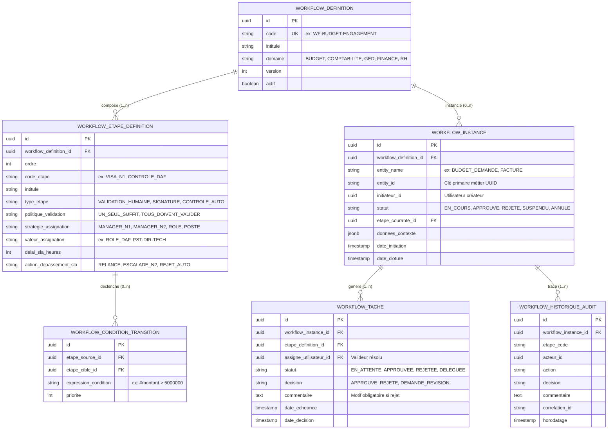
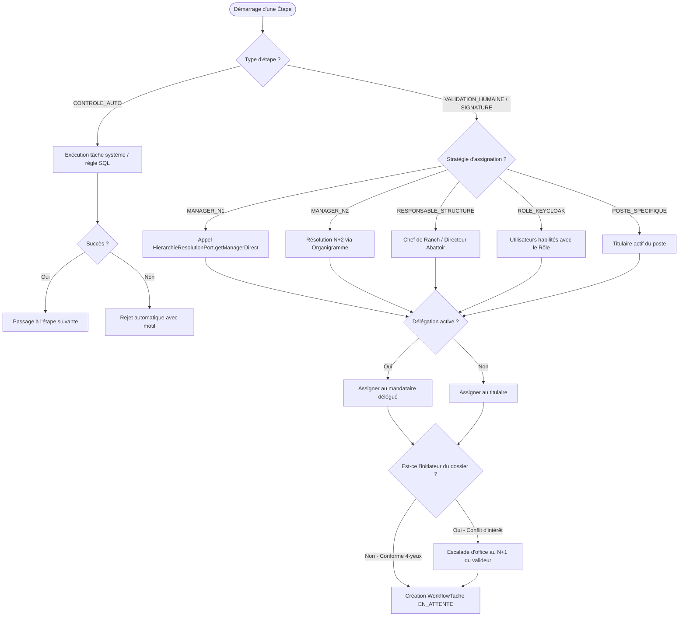

# SPÉCIFICATION DÉTAILLÉE DU MOTEUR DE WORKFLOW UNIVERSEL SODEPA
## Société de Développement et d'Exploitation des Productions Animales (SODEPA)

---

### 1. Contexte et Objectifs Métier

L'ERP SODEPA gère des activités réparties entre les services centraux de Yaoundé (Direction Générale, Direction Administrative et Financière, Direction Technique, Audit Interne, Contrôle de Gestion) et des unités opérationnelles décentralisées (Ranches de Jakiri, Dumbo et Faro, Abattoirs industriels de Yaoundé et Douala, Entrepôts frigorifiques).

Actuellement, les circuits de validation étaient soit figés dans le code (Maker-Checker élémentaire à 2 niveaux), soit disséminés dans des contrôles ad hoc.
Le **Moteur de Workflow Universel** a pour objectif de fournir un socle transverse, paramétrable sans re-développement (*No-Code / Low-Code*), capable d'orchestrer le cycle de vie de n'importe quel objet métier de l'entreprise :
- **Gestion Budgétaire** : Demandes d'engagement, dépassements de seuils, virements de crédits entre unités, réallocations.
- **Comptabilité Générale & Analytique** : Validation d'écritures sensibles, opérations d'inventaire, clôtures périodiques, lettrages dérogatoires.
- **Finance & Trésorerie** : Ordres de virement bancaire, demandes de décaissement, appels de fonds ranchs, double signature bancaire.
- **GED & Contrats** : Cycles de validation documentaire, visa juridique, circuits de signature électronique sécurisée (DG, DAF).
- **RH & Logistique** : Demandes d'achats locaux, bons de commande, ordres de mission sur le terrain, demandes de congés.

---

### 2. Principes Fondamentaux d'Ingénierie

1. **Agnosticisme Métier** : Le moteur manipule des concepts génériques (`entityName`, `entityId`, `donneesContexte`) sans dépendance directe vers les entités spécifiques de chaque module.
2. **Intégration Organigramme Dynamique** : Résolution automatique des approbateurs via `HierarchieResolutionPort` (Manager N+1, N+2, Chef de Ranch, Directeur d'Abattoir) avec substitution transparente en cas de délégation ou congé.
3. **Ségrégation Stricte des Tâches (Maker-Checker / 4-Eyes)** : Un utilisateur ne peut en aucun cas valider une étape sur un dossier qu'il a lui-même initié, même s'il possède le rôle ou le poste correspondant.
4. **Moteur d'Aiguillage Conditionnel** : Évaluation dynamique des règles de transition basées sur les métadonnées (montants, centres de coût, typologie d'unité, criticité).
5. **Gestion Temporelle des SLA & Escalades** : Surveillance des délais limites de traitement avec relances automatiques et escalade hiérarchique configurable.
6. **Piste d'Audit Infalsifiable** : Horodatage, capture des empreintes cryptographiques (SHA-256), identifiant de corrélation et export vers ClickHouse.

---

### 3. Modèle Conceptuel de Données (MCD)

---

### 4. Dictionnaire des Données Détaillé

#### A. Entité `WorkflowDefinitionEntity` (`workflows_definitions`)
| Colonne | Type | Nullable | Contraintes / Description |
| :--- | :--- | :---: | :--- |
| `id` | UUID | NON | Clé primaire |
| `code` | VARCHAR(60) | NON | Code unique du circuit (ex: `WF-ENGAGEMENT-DEPENSE`) |
| `intitule` | VARCHAR(150) | NON | Libellé lisible |
| `description` | TEXT | OUI | Documentation du processus |
| `domaine` | VARCHAR(40) | NON | `BUDGET`, `COMPTABILITE`, `GED`, `FINANCE`, `RH`, `ACHATS` |
| `version` | INT | NON | Numéro de version (défaut 1) |
| `actif` | BOOLEAN | NON | Indique si le circuit est sélectionnable |
| `date_creation`| TIMESTAMP | NON | Date de création |

#### B. Entité `WorkflowEtapeDefinitionEntity` (`workflows_etapes_definitions`)
| Colonne | Type | Nullable | Contraintes / Description |
| :--- | :--- | :---: | :--- |
| `id` | UUID | NON | Clé primaire |
| `workflow_definition_id` | UUID | NON | FK vers `workflows_definitions` |
| `ordre` | INT | NON | Numéro d'ordre séquentiel (10, 20, 30...) |
| `code_etape` | VARCHAR(60) | NON | Code unique au sein du workflow |
| `intitule` | VARCHAR(150) | NON | Libellé affiché sur le Stepper UI |
| `type_etape` | VARCHAR(40) | NON | `VALIDATION_HUMAINE`, `SIGNATURE_ELECTRONIQUE`, `CONTROLE_AUTO`, `NOTIFICATION` |
| `politique_validation`| VARCHAR(40) | NON | `UN_SEUL_SUFFIT`, `TOUS_DOIVENT_VALIDER`, `MAJORITE` |
| `strategie_assignation`| VARCHAR(40)| NON | `MANAGER_N1`, `MANAGER_N2`, `RESPONSABLE_STRUCTURE`, `ROLE_KEYCLOAK`, `POSTE_SPECIFIQUE`, `UTILISATEUR_FIXE` |
| `valeur_assignation` | VARCHAR(100)| OUI | Nom du rôle, code du poste ou identifiant utilisateur |
| `delai_sla_heures` | INT | OUI | Délai maximal de traitement (en heures) |
| `action_depassement_sla`| VARCHAR(40)| NON | `AUCUNE`, `RELANCE_EMAIL`, `ESCALADE_MANAGER`, `REJET_AUTOMATIQUE` |

#### C. Entité `WorkflowConditionTransitionEntity` (`workflows_conditions_transitions`)
| Colonne | Type | Nullable | Contraintes / Description |
| :--- | :--- | :---: | :--- |
| `id` | UUID | NON | Clé primaire |
| `etape_source_id` | UUID | NON | FK vers étape de départ |
| `etape_cible_id` | UUID | NON | FK vers étape suivante si condition vraie |
| `expression_condition` | VARCHAR(255)| OUI | Expression évaluée (ex: `#montant > 5000000 && #typeStructure == 'RANCH'`) |
| `priorite` | INT | NON | Ordre d'évaluation des branches |

#### D. Entité `WorkflowInstanceEntity` (`workflows_instances`)
| Colonne | Type | Nullable | Contraintes / Description |
| :--- | :--- | :---: | :--- |
| `id` | UUID | NON | Clé primaire |
| `workflow_definition_id` | UUID | NON | FK vers le circuit appliqué |
| `entity_name` | VARCHAR(60) | NON | Type d'objet métier (`BUDGET_DEMANDE`, `ECRITURE_COMPTABLE`, etc.) |
| `entity_id` | VARCHAR(100)| NON | Clé primaire de l'objet métier concerné |
| `initiateur_id` | UUID | NON | Utilisateur ayant déclenché la demande |
| `statut` | VARCHAR(30) | NON | `EN_COURS`, `APPROUVE`, `REJETE`, `SUSPENDU`, `ANNULE` |
| `etape_courante_id` | UUID | OUI | Pointeur vers l'étape active |
| `donnees_contexte` | CLOB / JSON | OUI | Variables capturées au démarrage (montant, centre, etc.) |
| `date_initiation` | TIMESTAMP | NON | Horodatage de lancement |
| `date_cloture` | TIMESTAMP | OUI | Horodatage d'achèvement |

#### E. Entité `WorkflowTacheEntity` (`workflows_taches`)
| Colonne | Type | Nullable | Contraintes / Description |
| :--- | :--- | :---: | :--- |
| `id` | UUID | NON | Clé primaire |
| `workflow_instance_id` | UUID | NON | FK vers l'instance en cours |
| `etape_definition_id` | UUID | NON | FK vers la définition d'étape |
| `assigne_utilisateur_id`| UUID | NON | FK vers `utilisateurs(id)` (le décideur) |
| `statut` | VARCHAR(30) | NON | `EN_ATTENTE`, `APPROUVEE`, `REJETEE`, `DELEGUEE`, `EXPIREE` |
| `decision` | VARCHAR(30) | OUI | `APPROUVE`, `REJETE`, `DEMANDE_REVISION` |
| `commentaire` | TEXT | OUI | Motif saisi par le décideur |
| `date_creation` | TIMESTAMP | NON | Création de la tâche |
| `date_echeance` | TIMESTAMP | OUI | Échéance calculée selon le SLA |
| `date_decision` | TIMESTAMP | OUI | Horodatage de la validation |

#### F. Entité `WorkflowHistoriqueAuditEntity` (`workflows_historique_audit`)
| Colonne | Type | Nullable | Contraintes / Description |
| :--- | :--- | :---: | :--- |
| `id` | UUID | NON | Clé primaire |
| `workflow_instance_id` | UUID | NON | FK vers l'instance |
| `etape_code` | VARCHAR(60) | NON | Code de l'étape franchie |
| `acteur_id` | UUID | NON | Identifiant de l'utilisateur exécutant |
| `action` | VARCHAR(40) | NON | `INITIATION`, `APPROBATION`, `REJET`, `DELEGATION`, `ESCALADE` |
| `decision` | VARCHAR(30) | OUI | Décision rendue |
| `commentaire` | TEXT | OUI | Motif consigné |
| `correlation_id` | VARCHAR(100)| OUI | Traçabilité technique distribuée |
| `horodatage` | TIMESTAMP | NON | Horodatage haute précision |

---

### 5. Algorithme d'Aiguillage et d'Assignation Dynamique

