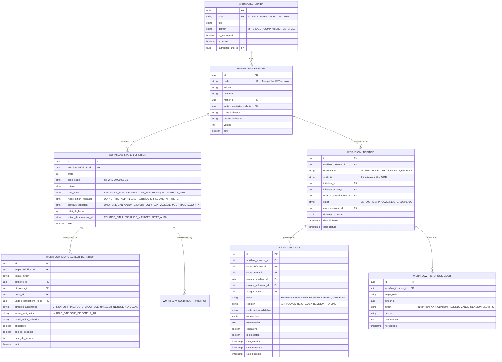
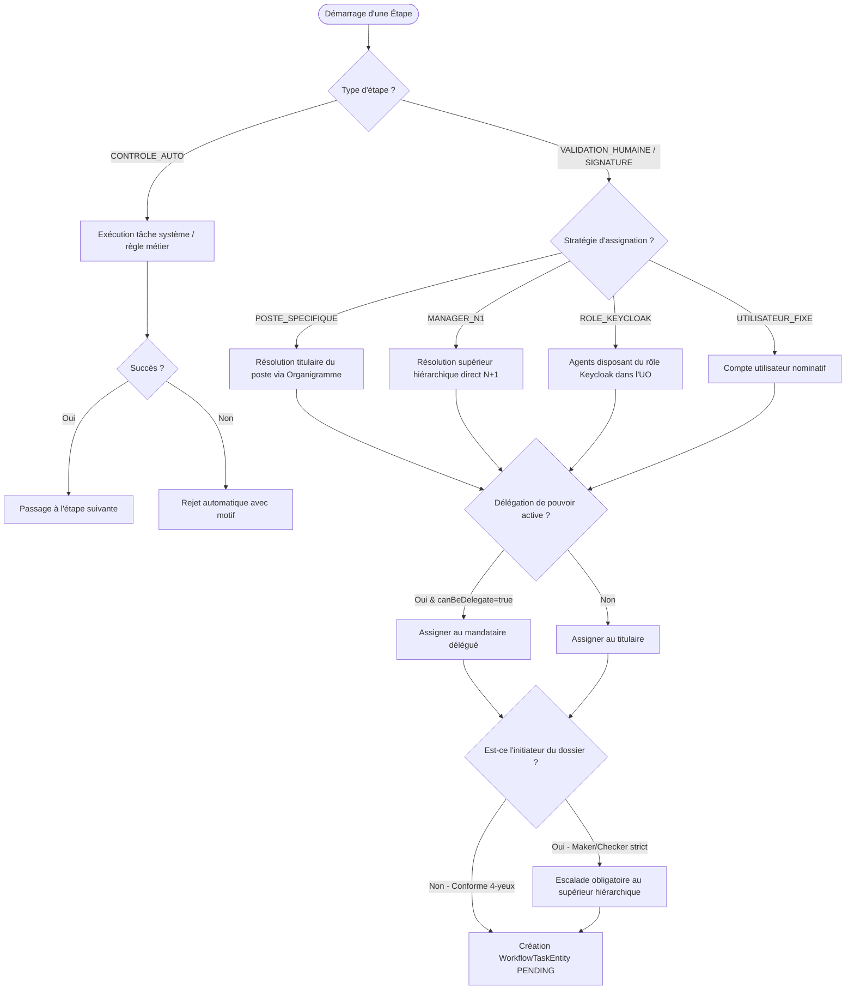

# SPÉCIFICATION DÉTAILLÉE DU MOTEUR DE WORKFLOW UNIVERSEL SODEPA
## Société de Développement et d'Exploitation des Productions Animales (SODEPA)

---

### 1. Contexte et Objectifs Métier

L'ERP SODEPA gère des activités réparties entre les services centraux de Yaoundé (Direction Générale, Direction Administrative et Financière, Direction Technique, Audit Interne, Contrôle de Gestion) et des unités opérationnelles décentralisées (Ranches de Jakiri, Dumbo et Faro, Abattoirs industriels de Yaoundé, Douala et Ngaoundéré, Entrepôts frigorifiques).

Le **Moteur de Workflow Universel** fournit un socle transverse, paramétrable sans re-développement (*No-Code / Low-Code*), capable d'orchestrer le cycle de vie de n'importe quel objet métier de l'entreprise :
- **Ressources Humaines** : Recrutement, titularisation, mutation, sanctions, avancements d'échelon.
- **Gestion Budgétaire** : Demandes d'engagement, dépassements de seuils, virements de crédits entre unités, réallocations.
- **Comptabilité Générale & Analytique** : Validation d'écritures sensibles, opérations d'inventaire, clôtures périodiques, lettrages dérogatoires.
- **Finance & Trésorerie** : Ordres de virement bancaire, demandes de décaissement, régies d'avance, double signature bancaire.
- **GED & Contrats** : Cycles de validation documentaire, visa juridique, circuits de signature électronique sécurisée (DG, DAF).
- **Achats & Pastoral** : Expressions de besoin, bons de commande, mouvements de cheptel, abattage.

---

### 2. Principes Fondamentaux d'Ingénierie

1. **Agnosticisme Métier & Pattern Strategy** : Le moteur manipule des concepts génériques (`entityName`, `entityId`, `donneesContexte`). Il délègue les mutations et la finalisation métier à des handlers dédiés implémentant [`WorkflowEntityHandler`](file:///c:/Users/GLC/Documents/sodepa/erp/src/main/java/com/sodepa/erp/workflow/application/handler/WorkflowEntityHandler.java).
2. **Intégration Organigramme Dynamique** : Résolution automatique des approbateurs via l'organigramme (Poste, Manager N+1, N+2, Chef de Ranch, Directeur d'Abattoir) avec prise en charge des **délégations de pouvoir** actives (`DelegationPouvoirEntity`).
3. **Ségrégation Stricte des Tâches (Maker-Checker / 4-Eyes)** : Un utilisateur ne peut en aucun cas valider une étape sur un dossier qu'il a lui-même initié.
4. **Verrous d'Action Granulaires (`ValidationStepActionMode`)** : Contrôle strict imposant ou non l'ajout de pièces justificatives (téléversement MinIO) ou la saisie de champs modifiés pour pouvoir valider une étape.
5. **Gestion Temporelle des SLA & Escalades** : Surveillance des délais limites de traitement avec calcul d'échéances et suspension des tâches concurrentes lors d'un renvoi pour révision (`ASK_REVISION`).
6. **Piste d'Audit Infalsifiable & Multi-Niveaux** : Horodatage, journalisation relationnelle locale (`workflows_historique_audit`) et ingestion analytique asynchrone dans ClickHouse (`clickhouse_workflow_events`).

---

### 3. Modèle Conceptuel de Données (MCD)

---

### 4. Dictionnaire des Données Détaillé

#### A. Entité `WorkflowDefinitionEntity` (`workflows_definitions`)
| Colonne | Type | Nullable | Contraintes / Description |
| :--- | :--- | :---: | :--- |
| `id` | UUID | NON | Clé primaire |
| `code` | VARCHAR(60) | NON | Code unique généré automatiquement via `CodeGenerator` (ex: `WFD-00000001`) |
| `intitule` | VARCHAR(150) | NON | Libellé explicite du circuit |
| `domaine` | VARCHAR(40) | NON | Énumération `WorkflowDomaine` (`RH`, `BUDGET`, `ACHATS`, `COMPTABILITE`...) |
| `metier_id` | UUID | OUI | FK vers `workflows_metiers` |
| `unite_organisationnelle_id` | UUID | OUI | FK vers `unites_organisationnelles` (cloisonnement) |
| `roles_initiateurs` | VARCHAR | OUI | Rôles Keycloak autorisés à initier ce workflow |
| `postes_initiateurs` | VARCHAR | OUI | Postes de l'organigramme autorisés à initier |
| `version` | INT | NON | Numéro de version incrémenté à chaque modification |
| `actif` | BOOLEAN | NON | Indique si le circuit est activable |
| `date_creation` | TIMESTAMP | NON | Date de création du circuit |

#### B. Entité `WorkflowEtapeDefinitionEntity` (`workflows_etapes_definitions`)
| Colonne | Type | Nullable | Contraintes / Description |
| :--- | :--- | :---: | :--- |
| `id` | UUID | NON | Clé primaire |
| `workflow_definition_id` | UUID | NON | FK vers `workflows_definitions` |
| `ordre` | INT | NON | Numéro d'ordre séquentiel d'exécution (1, 2, 3...) |
| `code_etape` | VARCHAR(60) | NON | Code unique au sein du circuit (ex: `WFD-00000001-E1`) |
| `intitule` | VARCHAR(150) | NON | Libellé affiché sur le Stepper UI |
| `type_etape` | VARCHAR(40) | NON | `VALIDATION_HUMAINE`, `SIGNATURE_ELECTRONIQUE`, `CONTROLE_AUTO` |
| `mode_action_validation` | VARCHAR(40) | NON | `DO_NOTHING`, `ADD_FILE`, `SET_ATTRIBUTE`, `FILE_AND_ATTRIBUTE`, `OPTIONAL_FILE_OR_ATTRIBUTE` |
| `politique_validation` | VARCHAR(40) | NON | `ONLY_ONE_CAN_VALIDATE`, `EVERY_BODY_CAN_VALIDATE`, `MUST_HAVE_MAJORITY` |
| `delai_sla_heures` | INT | OUI | Délai maximal de traitement alloué pour l'étape |
| `action_depassement_sla`| VARCHAR(40) | NON | `RELANCE_EMAIL`, `ESCALADE_MANAGER`, `REJET_AUTOMATIQUE` |
| `actif` | BOOLEAN | NON | Coupe-circuit : étape ignorée si `false` |

#### C. Entité `WorkflowEtapeActeurDefinitionEntity` (`workflows_etapes_acteurs_definitions`)
| Colonne | Type | Nullable | Contraintes / Description |
| :--- | :--- | :---: | :--- |
| `id` | UUID | NON | Clé primaire |
| `etape_definition_id` | UUID | NON | FK vers `workflows_etapes_definitions` |
| `intitule_action` | VARCHAR(150) | NON | Libellé explicite de l'action attendue |
| `employe_id` | UUID | OUI | Désignation nominative d'un employé |
| `utilisateur_id` | UUID | OUI | Liaison compte technique utilisateur |
| `poste_id` | UUID | OUI | Ciblage d'un poste de l'organigramme |
| `unite_organisationnelle_id` | UUID | OUI | Restriction d'affectation par cellule |
| `strategie_assignation`| VARCHAR(40) | NON | `UTILISATEUR_FIXE`, `POSTE_SPECIFIQUE`, `MANAGER_N1`, `ROLE_KEYCLOAK` |
| `valeur_assignation` | VARCHAR(100) | OUI | Consigne dynamique (ex: `"ROLE_DAF"`, `"CHEF_RANCH_FARO"`) |
| `mode_action_validation` | VARCHAR(40) | NON | Mode d'action spécifique exigé de cet acteur |
| `donnees_json` | JSONB | OUI | Dictionnaire de configuration dynamique des champs |
| `obligatoire` | BOOLEAN | NON | `true` = approbation indispensable pour franchir l'étape |
| `can_be_delegate` | BOOLEAN | NON | Indique si cet acteur peut être suppléé par délégation active |
| `delai_sla_heures` | INT | OUI | SLA spécifique à cet acteur |
| `actif` | BOOLEAN | NON | Coupe-circuit acteur |

---

### 5. Algorithme d'Aiguillage et de Contrôle d'Assignation

---

### 6. Remplacement Définitif de `MakerCheckerEnginePort` et Convergence

L'ancienne interface `MakerCheckerEnginePort` et son implémentation `MakerCheckerEngineAdapter` ont été complètement supprimées au profit du **Moteur de Workflow Universel** (`WorkflowService`).

#### A. Principes de la Convergence
1. **Point d'Entrée Unique** : Tous les domaines métiers de l'ERP (Achats, Budget, Comptabilité, Organigramme, Paie, Pastoral, RH, Trésorerie, Utilisateurs) injectent directement `WorkflowService`.
2. **Double Bénéfice** :
   - Préservation de la signature d'appel `submitChange(entityName, entityPk, payload, operationType)` pour la rétrocompatibilité des 15 adaptateurs métiers.
   - Instanciation automatique et transparente d'un graphe de workflow (`WorkflowInstanceEntity`) rattaché à l'entité, avec assignation d'acteurs réels et évaluation d'étapes.
3. **Observabilité Immédiate** : Publication automatique des événements de soumission et de décision vers RabbitMQ pour ingestion dans la base analytique ClickHouse.

---

### 7. Orchestration Multi-Domaines et Événements Découplés

Le moteur de workflow universel permet à un circuit de validation de faire collaborer plusieurs modules métiers sans couplage fort :
- **Chaîne ordonnée de Handlers (`WorkflowEntityHandlerRegistry`)** : Exécute tous les `WorkflowEntityHandler` enregistrés pour une entité donnée en respectant leur priorité `@Order`.
- **Événements de Domaine Spring** :
  - `WorkflowStepApprovedEvent` : Notifie les modules à chaque franchissement d'étape avec les modifications apportées.
  - `WorkflowInstanceCompletedEvent` : Notifie de l'approbation définitive pour clôture ou activation métier.
  - `WorkflowInstanceRejectedEvent` : Notifie du rejet pour libération des réservations (ex: déblocage de crédits budgétaires).
  - `WorkflowRevisionRequestedEvent` : Notifie de la demande de révision (`ASK_REVISION`) pour correction par l'initiateur.

---

### 8. Sécurité, Verrouillage Optimiste et Traitement des Exceptions

1. **Sécurité RBAC Granulaire** : Contrôle systématique des permissions `WORKFLOW_READ`, `WORKFLOW_CONFIG`, `WORKFLOW_SUPERVISION` et `WORKFLOW_DECISION`.
2. **Identification JWT** : L'identité de l'agent est extraite du contexte de sécurité JWT officiel, empêchant toute usurpation par injection d'identifiant arbitraire.
3. **Anti Auto-Approbation (Règle des 4 Yeux)** : Rejet strict (`AccesRefuseException`) si un utilisateur tente de valider une tâche d'une instance qu'il a lui-même initiée.
4. **Verrouillage Optimiste** : Les entités `WorkflowInstanceEntity` et `WorkflowTaskEntity` portent l'annotation JPA `@Version`, prévenant les écritures concurrentes et les accès concurrents non autorisés.
5. **Gestion d'Erreurs Typées** : Rejet normalisé via les exceptions `RequeteInvalideException` (HTTP 400), `AccesRefuseException` (HTTP 403), `RessourceIntrouvableException` (HTTP 404), et `ConflitMetierException` (HTTP 409).
